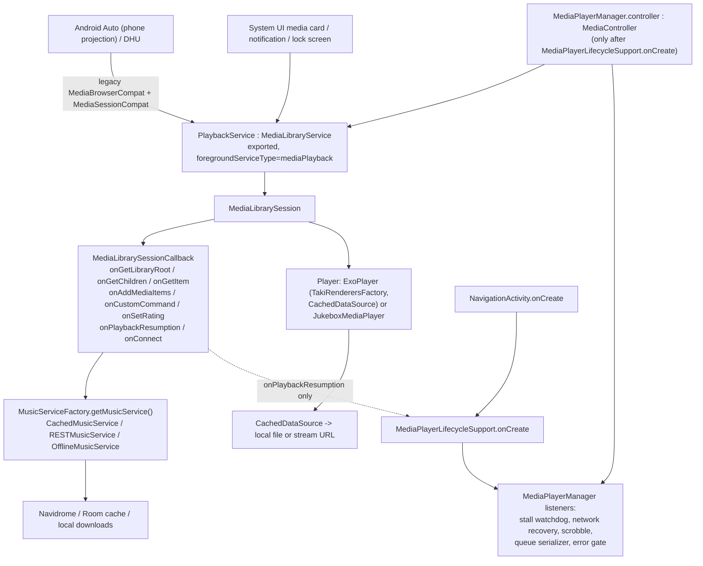

# Taki Android Auto: pre-beta architecture, compatibility and experience audit (Phase A)

Date: 2026-10-18. Tracking issue: #43 (umbrella, part of #36). Scope: static audit of the existing Android Auto integration. No production code, dependency or
device state was changed. Runtime behaviour in a real Android Auto environment is **not** verified by this document
(Phase B, section 15, covers that). Evidence labels used below:

- `CODE` - read directly from the repository (file:line at `develop` `8e5e7a04`).
- `LIB` - read from the shipped library bytecode (Media3 session 1.10.1, androidx.car.app 1.7.0) with `javap`.
- `DOC` - official Android developer documentation (fetched 2026-10-18); external claims are flagged as such.
- `UNVERIFIED` - inference that needs a runtime check.

## 1. Executive summary

Android Auto support is **present and architecturally sound at its core**: one Media3 `MediaLibraryService`
(`PlaybackService`) owns the single `ExoPlayer`, and the car, the notification, the phone app's own
`MediaController` and the lock-screen card all talk to that same player. There is no second playback engine.
Browsing, "play all", favourites, random songs, heart/shuffle/repeat custom actions, playback resumption (#37)
and an artwork provider are implemented, and the pagination design (manual "Show More" items with a 100-item
page) matches what the official docs say Android Auto supports.

No critical (P0) defect was found. Two findings need attention before declaring Android Auto beta-ready:

1. **AA-01 (P1, confirmed statically).** The "brain" that makes Taki's playback robust - the stall watchdog (#17),
   transient-network recovery (#19), controller rebuild (#18), scrobbling, error reporting and queue persistence -
   lives in `MediaPlayerManager`, attached through a `MediaController` that is only created by
   `MediaPlayerLifecycleSupport.onCreate()`. That is called by `NavigationActivity`, the media-button receiver path
   and `onPlaybackResumption` - **not** by `PlaybackService`, `onConnect` or any browse callback. A cold Android
   Auto session that never opens the phone UI therefore plays on the bare service player without those safeguards.
2. **AA-02 (P1 candidate, effect unverified).** Artist, album, playlist and sub-folder rows are built through an
   overload that sets `isBrowsable=false` and `isPlayable=false`; Media3 converts that to legacy flags `0`. The docs
   do not say how Android Auto renders a flag-less item. If it is not clickable, artist/album/playlist browsing is
   broken. This must be the first thing checked on the Desktop Head Unit.

Several P2 findings are lifecycle and robustness issues (an unbounded `CarConnection` observer, repeat-mode
override/restore semantics, a playlist cache not keyed by playlist, single-song queues, blocking calls on the
main thread, search gaps, no caller validation on the exported service). They are real code facts but have
bounded impact and are good targets for a small correction phase after Phase B.

**Beta readiness: REQUIRES_RUNTIME_VALIDATION.** Phase B can start without code changes.

## 2. Repository baseline

| Item | Value |
|---|---|
| develop HEAD / tree | `8e5e7a04`, working tree clean at audit start |
| Media3 | 1.10.1 (`media3-session`, `exoplayer`, `common`, `datasource(-okhttp)`, `inspector`), NextLib 1.10.1-0.13.0 |
| Car library | `androidx.car.app:app:1.7.0` (`libs.versions.toml:7`, `ultrasonic/build.gradle:207`); used only for `CarConnection` |
| minSdk / targetSdk | 26 / 37 (`versions.*` via `ultrasonic/build.gradle`), `<uses-sdk tools:overrideLibrary="androidx.car.app"/>` |
| Application IDs | release `io.github.churipakinti.taki`; debug `io.github.churipakinti.taki.debug` (`applicationIdSuffix`) - installable side by side |
| Android Automotive OS | not declared (no `android.hardware.type.automotive` feature, no AAOS-specific entries) |
| History | file is the Ultrasonic `AutoMediaBrowserCallback` ported to Media3 (2021-2023, upstream authors); Taki additions: resumption future (#37, `e66b15cd`), chunked Shuffle (HANDOFF), heart plumbing (#1, #15), native `HeartRating` icons |
| Existing GitHub issues | none cover Android Auto (searched all states); related: #17, #19, #34, #35, #37, #39, #40 |
| Inherited vs Taki | callback structure, `DISPLAY_LIMIT`, "Show More", repeat-all-on-projection (upstream `82f67586`, 2023-08-09), `observeForever` code: **inherited**. Resumption future, shuffle chunking, heart icon/rating pipeline, hardened artwork provider, monochrome notification icon: **Taki**. |
| Existing automated AA tests | **none** for `MediaLibrarySessionCallback`, `CarConnection` or browse trees (see section 12) |

## 3. Android Auto architecture



Entry points (all `CODE`):

- Discovery: `AndroidManifest.xml:45-46` `com.google.android.gms.car.application` -> `res/xml/automotive_app_desc.xml`
  (`<uses name="media"/>`); `:48-50` `com.google.android.gms.car.notification.SmallIcon` -> `@mipmap/ic_launcher`.
- Connection: `PlaybackService` (`:81-92`) is exported, `foregroundServiceType="mediaPlayback"`, with
  `androidx.media3.session.MediaLibraryService` and `android.media.browse.MediaBrowserService` actions.
  `FOREGROUND_SERVICE_MEDIA_PLAYBACK` is declared. The merged manifest also contains the car library's
  `androidx.car.app.connection.provider` provider (used by `CarConnection`); there is no `CarAppService`.
- Session: `PlaybackService.initializeSessionAndPlayer()` (`PlaybackService.kt:182-261`) builds the player
  (`createNewBackend`), then `MediaLibrarySession.Builder(this, player, MediaLibrarySessionCallback())` with
  `ArtworkBitmapLoader` and a session activity.
- Server change / jukebox switch: `updateBackend()` (`:263-293`) releases the player, builds a new one and does
  `mediaLibrarySession.player = player` (the callback is not recreated).
- Teardown: `onTaskRemoved` and `onDestroy` both call `releasePlayerAndSession()` (`:102-131`), i.e. swiping the
  task away stops playback by design (documented in the log message).
- Single engine: AA resolves items to `Track.toMediaItem()` (`MediaItemConverter.kt:61`), whose URI is
  `id|bitrate|filePath` - the same resolver and `CachedDataSource` path the phone UI uses. No separate car player.

## 4. Feature inventory

| Capability | Status | Evidence |
|---|---|---|
| Discoverable media app (`automotive_app_desc` media) | IMPLEMENTED (runtime unverified) | manifest `:45-46` |
| Media3 library integration (root, children, item, resumption) | IMPLEMENTED | callback `:204`, `:392`, `:416`, `:255` |
| Legacy `MediaBrowserService` compatibility | IMPLEMENTED via Media3 legacy stub | manifest `:89-90`; `LIB` `MediaLibraryServiceLegacyStub` |
| Browse: Library (random songs, liked songs, newest/recent/frequent/random/liked albums), Artists, Albums, Playlists | CODE_IMPLEMENTED | `getRootItems :783`, `getLibrary :829` |
| Offline browsing (Artists, Playlists; Library/Albums hidden) | CODE_IMPLEMENTED | `getRootItems :786-815` |
| Play album / playlist / liked / random ("Play All") | CODE_IMPLEMENTED | `addPlayAllItem :1338`, `onAddLegacyAutoItems :570` |
| Play a single song from a list | CODE_IMPLEMENTED (single-item queue, AA-07) | `playAlbumSong :1166` |
| Play artist directly (e.g. from search) | NOT_IMPLEMENTED | TODO at `:700`, `:740` |
| Browse search (`onSearch`/`onGetSearchResult`) | NOT_IMPLEMENTED | not overridden (grep) |
| Voice play-from-search | PARTIALLY_IMPLEMENTED | `onAddMediaItems :546` -> `playFromSearch :671` (AA-09) |
| Heart / shuffle / repeat custom actions | CODE_IMPLEMENTED | `onCustomCommand :428`, `buildCustomCommands :1400` |
| Playback resumption (media button after process death) | IMPLEMENTED (bounded future, #37) | `:255-280`, `RESUMPTION_TIMEOUT_MS` |
| Artwork for tracks | IMPLEMENTED via hardened content provider | `AlbumArtContentProvider` |
| Artwork for album/artist/playlist rows | NOT_IMPLEMENTED | rows built without `imageUri` (AA-11) |
| `notifyChildrenChanged` / refresh on server or offline change | NOT_IMPLEMENTED | grep: none |
| Content style hints | PARTIAL: only the group-title hint | `MediaItemConverter.kt:28-29,314` |
| Android Automotive OS | NOT_IMPLEMENTED (out of scope) | no automotive feature |

## 5. Navigation tree (as coded)

```
Root (MEDIA_ROOT_ID, FOLDER_MIXED)                       onGetLibraryRoot :204 (immediate future)
├─ Music Library (MEDIA_LIBRARY_ID) [online only]        getLibrary :829
│   ├─ Random songs (MEDIA_SONG_RANDOM_ID, browsable)    getRandomSongs :1222  (Play All + <=100 songs)
│   ├─ Liked songs  (MEDIA_SONG_STARRED_ID, browsable)   getStarredSongs :1173 (Play All + first 100)
│   ├─ Newest / Recent / Frequent / Random / Liked albums getAlbums(type) :1025 (100 + "Show More" page item)
├─ Artists (MEDIA_ARTIST_ID)                              getArtists :887
│   ├─ <=100 artists -> artist rows (MEDIA_ARTIST_ITEM|id|name)
│   └─ >100 -> alphabetical section rows (MEDIA_ARTIST_SECTION|X) -> artist rows (unbounded within a section)
│        └─ artist -> albums (MEDIA_ALBUM_ITEM|id|name)   getAlbumsForArtist :943
│             └─ album -> [Play All] + songs (MEDIA_ALBUM_SONG_ITEM|albumId|name|songId, first 100)  getSongsForAlbum :971
├─ Albums (MEDIA_ALBUM_ID) [online only]                  getAlbums(SORTED_BY_NAME) :1025, pages via MEDIA_ALBUM_PAGE_ID|type|n
└─ Playlists (MEDIA_PLAYLIST_ID)                          getPlaylists :1077 (all playlists, no limit)
     └─ playlist -> [Play All if >1] + first 100 songs (MEDIA_PLAYLIST_SONG_ITEM|...)  getPlaylist :1097
```

Per level: data comes from `MusicServiceFactory.getMusicService()` (re-resolved per call, so a server switch is
picked up); all calls hop `mainScope.future { serviceScope.future { ... }.await() }` (the code comment says Media3
needs the main thread while networking must not run on it); media IDs are `TYPE|id|name[|songId]` strings;
parents are encoded in the ID so Back is handled by Android Auto's own history; failures return an **empty
successful list** (`callWithErrorHandling :1359`) rather than an error.

### Pagination and the limits (valid design, with caveats)
- `DISPLAY_LIMIT = 100` (`:88`) is applied as: album lists - server-side `size=100&offset=page*100` with a
  "Show More" browsable item when a full page came back (`getAlbums :1032-1071`, stable ordering for
  `SORTED_BY_NAME`/`NEWEST`/`RECENT`/`FREQUENT`/`STARRED`; `RANDOM` can repeat across pages); artists > 100 -> letter
  index; songs in album / playlist / liked: `take(100)` for display only.
- `onGetChildren` **ignores `page`, `pageSize` and `params`** (`:416-426`). `DOC`: "Android Auto and AAOS don't
  support pagination ... don't rely on the page or pageSize parameters" - so this is **correct for Android Auto**.
  `LIB`: legacy browsers get `pageSize = Integer.MAX_VALUE` unless they pass `EXTRA_PAGE_SIZE`; a Media3
  `MediaBrowser` client that passes a smaller `pageSize` would make `MediaLibrarySessionImpl` throw
  `IllegalStateException("Invalid size=..., pageSize=...")` (low relevance: only Taki's own controller uses it).
- "Play All" is not capped: `playAlbum`/`playPlaylist` return all tracks, but `playStarredSongs` plays the cached
  `take(100)` list (AA-07).
- No item becomes unreachable beyond 100 in album lists. Within a >100 artist section, the section itself is not
  paged. Albums with >100 tracks show only the first 100 rows (Play All still plays all).

## 6. Playback and queue integration

- All custom actions and queue changes go to the one session player: `session.player` for shuffle/repeat
  (`:450-458`), `onSetRating` -> `RatingManager` (`:479-530`).
- Item resolution: Media3-aware controllers send `requestMetadata.mediaUri` and the item is rebuilt with that URI
  (`:550-559`); legacy Android Auto sends only a media ID and goes through `onAddLegacyAutoItems` (`:570-616`),
  which resolves the tracks (Room/network) and returns `Track.toMediaItem()`. Both paths end in the same player,
  `CachedDataSource` (local file or stream), `TakiRenderersFactory` (hi-res FFmpeg, #17), offload and watchdog
  policies; nothing in the car path bypasses cache/download/resolver logic.
- **Controller-side safeguards (AA-01).** The following exist only on `MediaPlayerManager.listeners`, attached to
  its `MediaController` (`MediaPlayerManager.kt:604-625`): stall watchdog tick (`:249-257`, #17 FIX B), transient
  network recovery (`:373-413`, #19), error reporting and album-cache invalidation (`:418-446`), scrobbling
  (`:316-320`), sleep-timer completion, queue checkpoints/serialisation (`:249-257`, `:1281`, `:1355`). The
  controller is created by `MediaPlayerManager.onCreate` (`:525`) <- `MediaPlayerLifecycleSupport.onCreate`
  (`:56-60`) <- `NavigationActivity.onCreate` (`:391`), `UltrasonicIntentReceiver` command path, and
  `onPlaybackResumption` (`MediaLibrarySessionCallback.kt:262`). `PlaybackService.onCreate` does not call it; the
  only service-side use is `serializeCurrentSessionSync()` at teardown (`PlaybackService.kt:119`), which returns
  early when `currentMediaItemIndex == -1` (controller absent). `RxBus.createServiceCommandPublisher`
  (`RxBus.kt:114`) has a subscriber in `MediaPlayerLifecycleSupport:45` but nothing publishes to it.
  Consequence for an AA-only session: no silent-stall backstop, no in-place network retry (#19), no scrobble,
  no persisted queue, and a phone UI that attaches later only sees the state after the fact. `UNVERIFIED` at
  runtime: confirm that the log line `MediaPlayerController started` never appears in a cold AA session.
- Errors: a playback error is delivered by Media3 to Android Auto as a playback-state error; Taki's friendly
  message (`reportPlaybackError`) is also controller-side. Errors cannot silently advance the queue from the
  callback code itself (the callback never skips).
- Commands: `onConnect` (`:224-244`) accepts every controller, adds the custom session commands and calls
  `configureRepeatMode`. All exposed commands map to real `Player` operations; the "Placeholder" button is
  disabled by design (it pads the button layout when there is no Next item, `:1410-1417`).
- Queue shape: tapping a song plays **that song only** (`playAlbumSong/playPlaylistSong/playStarredSong/
  playRandomSong/playSearch` all return `listOf(song)`, `:778`, `:1156`, `:1169`, `:1218`, `:1266`); the full
  context is queued only through the "Play All" row. The code comment states Android Auto "only select[s] a single
  item at once".
- Resumption (#37): bounded by a 20 s timeout and completes with the restored queue or an error (`:255-280`) -
  well implemented and covered by unit tests of `resumptionOf`.
- Interaction with prior fixes: #17 (FFmpeg route) is renderer-level and applies to car playback; the watchdog and
  #19/#18 recovery do not (AA-01); #34 audio focus is configured in the player builder (applies); #37 applies;
  #39/#40 are download/`CachedDataSource` level (apply). No completed issue needs re-opening on this evidence.

## 7. Connection lifecycle (`CarConnection`)

`configureRepeatMode(session.player)` (`:282-314`) is called from **every** `onConnect` (`:238`) - including the
phone app's own controller, the notification and System UI - not only from Android Auto. Each call:
1. creates a new `CarConnection(UApp.applicationContext())` and calls `.type.observeForever { ... }` (`:289`);
2. captures `player` and `player.repeatMode` at that moment as `originalRepeatMode`;
3. is never removed (`removeObserver` does not appear for it; the service has no teardown hook for it).

`LIB`: `CarConnectionTypeLiveData.onActive()` calls `Context.registerReceiver(...)` and `queryForState()` issues an
`AsyncQueryHandler.startQuery`; `onInactive()` unregisters. Because the observer is never removed, every
`onConnect` leaves one registered receiver, one content query on each active state and one lambda that holds the
captured `player` and the callback alive until the process dies. Duplicate observers are tolerated only because the
shared `customRepeatModeSet` flag makes all but the first one a no-op, which also means the **first** observer's
captured `originalRepeatMode` is the one that is restored (see section 8). This is an unmanaged lifecycle with
retained references, not just a style issue; its practical cost per connect is small but unbounded over a long
process life (Taki controllers reconnect on rebuild, app launches, notification refresh).

Other lifecycle facts: `updateBackend()` replaces the player (`:285-290`) but the captured `player` in older
observers still points at the released instance, so a later repeat change would be applied to a dead player and the
live one would keep its mode (`UNVERIFIED` runtime effect). `CONNECTION_TYPE_NATIVE` (AAOS) is deliberately
ignored. `serviceJob`/`serviceScope`/`mainScope` (`:106-108`) are never cancelled; coroutines in flight at
`onDestroy` are left to finish. Disconnection is handled only through the `NOT_CONNECTED` event of that observer.

## 8. Repeat and shuffle behaviour

- Origin: upstream Ultrasonic commit `82f67586` (2023-08-09, "Utilize CarConnection to determine whether to set
  repeat mode to ALL"), which replaced an unconditional `player.repeatMode = REPEAT_MODE_ALL` in `onConnect`. The
  rationale is not documented in Taki's docs. It is inferred from the layout code: with `REPEAT_MODE_ALL` the
  Next button stays available on the last item, otherwise a disabled "Placeholder" is inserted
  (`buildCustomCommands :1410-1417`). Not required by Android Auto (`DOC` lists no such rule).
- Effects (all `CODE`): while projecting, repeat is forced to ALL once (`:299-304`); when the type becomes
  `NOT_CONNECTED` it restores `originalRepeatMode` (`:306-311`).
  - It **overwrites the user's repeat preference** while projected, and because the controller-side serializer
    persists `repeatMode` (`MediaPlayerManager.kt:1287`) the forced ALL can be saved if the process dies while
    connected (only if AA-01's manager is attached).
  - `originalRepeatMode` is a snapshot from the *first* `onConnect` of the process, not from the moment the car
    connected: if the user changes repeat after that and then plugs in the car, disconnecting restores the stale
    value.
  - A repeat toggle from the car sets `customRepeatModeSet = true` (`:455`), so on disconnect the user's in-car
    choice is reverted to the stale snapshot, and projection start will not re-apply ALL.
  - Unexpected disconnects follow the same path; if the process is killed there is no restore and (with the
    manager attached) ALL can persist.
- Shuffle: custom command shuffles the queue **after** the current item in chunks with yielding and the timeline
  publish suppressed (`:1446-1482`) - the chunked ANR protection from the earlier audit; correct and worth keeping.
  Shuffle availability requires more than 2 items (`canShuffle :1398`).
- Verdict: intentional, upstream-inherited, mostly safe, but its snapshot/flag semantics are fragile. Do not
  remove it without an approved behaviour change; test the sequences in section 15 (scenarios 11, 13).

## 9. Artwork, metadata and presentation

- Track artwork: `toMediaItem` -> `AlbumArtContentProvider.mapArtworkToContentProviderUri` (`content://<id>.provider.AlbumArtContentProvider/<coverArt>|<md5>_large`). The provider is exported (needed by Android Auto and
  the launcher) but validates the key pattern, requires the `(coverArtId, key)` pair to have been minted by Taki
  and checks canonical containment in the artwork directory; unit-tested (`AlbumArtContentProviderTest`, 6
  tests). Preserve this.
- Gaps: album, artist, playlist and folder rows carry no `artworkUri` and no subtitle (`buildMediaItem` called
  without `imageUri`/`artist` in the `String` overload) - Android Auto lists show text only (AA-11). Root and
  library rows use `android.resource://` drawables (`Util.getUriToDrawable`) which Android Auto reads itself.
  `openFile` triggers an asynchronous cover download and returns `null` when the file is not yet on disk, so the
  first request for uncached art can fail; the minted-key map is in memory only (`UNVERIFIED` impact).
  `ArtworkBitmapLoader.load` does `require(parts.count() == 2)` (`:60`): non-`id|key` URIs would throw
  synchronously (they are not routed there in the current flows).
- Identity: app label and about text say Taki; the notification small icon for the media notification is the
  monochrome `ic_launcher_monochrome` (`PlaybackService.kt:92`), but the Android Auto notification icon metadata
  points at the colour `@mipmap/ic_launcher` (`AndroidManifest.xml:48-50`), whereas Android Auto notification icons
  are normally monochrome (`UNVERIFIED` rendering). Remaining Ultrasonic-era strings visible to the system: the error
  notification channel name `"Ultrasonic error messages"` (`PlaybackService.kt:483`, only in system notification
  settings); custom action labels are hard-coded English: "Love", "Dislike", "Shuffle", "Repeat None/One/All"
  (`:328-389`) and the root title "Root Folder" (`:214`); none are localised (AA-13).
- Heart state: `HeartRating` icons are the app's own heart drawables; `setStarred()` keeps the MediaItem in sync
  (#1/#15), so the heart shown for the playing item follows `onMediaItemTransition`.
- Do not build a custom car UI; Android Auto controls the presentation.

## 10. Performance and reliability

- Futures: every browse future either completes with a list or an empty list (`callWithErrorHandling` swallows
  exceptions); a hung HTTP call is bounded only by the network client's own timeouts. `onGetLibraryRoot` is an
  immediate future, matching the doc requirement to return the root quickly (`DOC`). `onPlaybackResumption` has an
  explicit timeout. There is no timeout/cancel on browse futures and no error state (AA-10).
- Main-thread waits (AA-08): `onAddMediaItems`/`onGetItem` run on the session's application looper (the main
  looper). `onAddLegacyAutoItems`/`tracksFromMediaId` call helpers that block with `serviceScope.future{...}.get()`
  (`:1138-1141`, `:1150-1153`, `:1254-1256`, `:1272-1287`). Albums are cache-first (`CachedMusicService` reads the
  persisted Room rows first, `CachedMusicService.kt:243-247`), so album play after browsing is a short DB read;
  playlists, liked songs, random songs and search have no such cache once the in-memory copies are gone, so those
  paths wait for a network call on the main thread (ANR risk when the server is slow or unreachable).
- Stale state: `playlistCache`, `starredSongsCache`, `randomSongsCache`, `searchSongsCache` (`:110-113`) are never
  invalidated on server or offline change; `playPlaylist/playPlaylistSong` do not check the cache belongs to the
  requested playlist id (AA-06). `notifyChildrenChanged` is never called, so a server switch or offline toggle does
  not refresh a car screen that is already open.
- ID parsing: IDs are `|`-joined and indexed positionally (`:576-603`); names containing `|` shift the fields.
  `getSectionFromName(name)` calls `name.first()` (`:1349`) and would throw for an empty artist name, failing the
  whole artist list future. Album folder rows are sorted **after** `take(100)` with a comparator that returns 1 for
  two files (`:988-998`), which violates the `Comparator` contract (harmless for small lists).
- Large libraries: artists use a letter index above 100; albums page server-side; playlists are returned in full;
  artist sections and playlist rows are not paged. Network cost per browse is one cached call; no per-item calls.
- Security/privacy (AA-05): `PlaybackService` is exported (required) and `onConnect` accepts every caller, and
  `onGetLibraryRoot` serves the library to any bound client; there is no package/signature allow-list, so any
  installed app can browse metadata, control playback and invoke the custom commands (heart, shuffle, repeat).
  `UltrasonicIntentReceiver` is also exported for transport commands. This is the common open-by-default pattern
  for media apps but has no mitigation.
- Background execution: `foregroundServiceType=mediaPlayback` and `onForegroundServiceStartNotAllowedException`
  handling exist (`PlaybackService.kt:436-468`).

## 11. Existing test coverage

Related tests that exist and were run for this audit (33 tests, 0 failures, `:ultrasonic:testDebugUnitTest` filter):
`PlaybackResumptionTest` (4), `MediaPlayerLifecycleSupportTest` (3), `QueueRestoreRoundTripTest` (5),
`MediaItemTransitionRoutingTest` (9), `AlbumArtContentProviderTest` (6), `MediaItemConverterStarredTest` (6).

| Scenario | Covered |
|---|---|
| Resumption queue contract | yes (`resumptionOf`), not the future wiring |
| Artwork provider validation | yes |
| Media-item conversion / heart state | yes |
| Root browsing, artist/album/playlist navigation, media IDs, "Show More" paging | **no** |
| Browsable/playable flags | **no** |
| Search / voice play | **no** |
| Offline root | **no** |
| Server error / empty result handling | **no** |
| `CarConnection` lifecycle, repeat override/restore | **no** |
| Custom commands (heart/shuffle/repeat) | **no** |
| Cold-start (no activity) behaviour of the controller-side manager | **no** |

## 12. Confirmed defects versus potential risks

Confirmed by code or library bytecode (facts): AA-01, AA-03, AA-04, AA-05, AA-06, AA-07, AA-08, AA-09, AA-10, AA-11,
AA-12, AA-13. Effect not known without a runtime check: AA-02 (and the runtime impact of AA-01/AA-03/AA-08).
No confirmed P0. Counts: P0 confirmed 0; P1 confirmed 1 (AA-01) plus 1 unverified candidate (AA-02); P2 8; P3 4.

## 13. Prioritised findings

| ID | Sev | Component | Location | Observed | Expected | Evidence / confidence | Runtime test | Next action |
|---|---|---|---|---|---|---|---|---|
| AA-01 | P1 | Controller-side safeguards | `PlaybackService.kt:90-261`, `MediaPlayerManager.kt:525-625`, `MediaPlayerLifecycleSupport.kt:56-60`, `MediaLibrarySessionCallback.kt:224-244` | Watchdog, #19 recovery, scrobbling, error reporting and queue persistence attach only through `MediaPlayerManager.onCreate`, not triggered by service start, `onConnect` or browse | Car playback gets the same safeguards as phone playback | CODE, high | yes (cold DHU start, check `MediaPlayerController started`) | small fix: start the lifecycle support from the service/`onConnect` (decision needed), plus a test |
| AA-02 | P1 candidate | Browse flags | `MediaLibrarySessionCallback.kt:1289-1304`, `MediaItemConverter.kt:277-` | Artist/album/playlist/folder rows use the `String` overload (`isBrowsable=false`, playable false) -> legacy flags 0 (`LIB LegacyConversions.convertToBrowserItem`) | Browsable folder rows, playable leaves | CODE+LIB for the flags, effect UNVERIFIED (docs silent) | **first DHU check** | if broken, set `isBrowsable=true` for folder rows; add a unit test of flags |
| AA-03 | P2 | CarConnection | `:282-314` | Observer per `onConnect`, never removed, captures player and callback | One owner, removed on teardown | CODE+LIB, high | optional (count receivers over reconnects) | single observer owned by the callback/service, removed in `onDestroy` |
| AA-04 | P2 | Repeat mode | `:285-311`, `:455` | Stale snapshot restore, overwrites preference, in-car toggle reverted | Restore the value the user had when the car connected | CODE, high | yes (section 15 #11/#13) | record/restore at projection start; keep ALL behaviour |
| AA-05 | P2 | Session access | `:224-244`, manifest `:81-92` | Any app may connect and browse/control | Allow-list or trusted-caller check for non-system controllers | CODE, high | no | decision; small `onConnect` check keeping Android Auto/System UI/Assistant |
| AA-06 | P2 | Playlist play | `:1134-1158` | `playlistCache` returned without checking playlist id or server | Cache keyed by playlist id and server | CODE, high | yes (open playlist A, then B, replay A) | key or drop the cache; invalidate on server switch |
| AA-07 | P2 | Queue shape | `:778`, `:1156`, `:1169`, `:1187-1209`, `:1218`, `:1266` | Song tap = single-item queue; liked "Play All" plays only the first 100 | Album/playlist context queued; full liked list | CODE, high | yes (UX) | queue the parent list from the chosen song; decide on liked limit |
| AA-08 | P2 | Main-thread blocking | `:1138-1141`, `:1150-1153`, `:1254-1256`, `:1272-1287` via `:399`, `:566` | `.get()` waits on the main looper for network | Async resolution | CODE, medium (album path cache-first) | yes (idle 15 min then play, offline server) | resolve asynchronously in `onAddMediaItems` |
| AA-09 | P2 | Search / voice | `:671-728`, `:546` | No browse search; voice picks the first album, throws on no result (`mediaItems.first()`, `:721`), no empty-query handling, comment claims exact match/random fallback | Graceful result or error; empty query plays something | CODE, high | yes (voice + DHU) | decide scope; fix the `first()` crash path at least |
| AA-10 | P2 | Errors / refresh | `:1359-1367`, no `notifyChildrenChanged` | Failures look like empty lists; no refresh on server/offline change | Visible error state, refresh on change | CODE, high | yes (server down, offline toggle) | small: return an error result; notify on server change |
| AA-11 | P3 | Artwork/metadata | `:1289-1304`, `AlbumArtContentProvider.openFile`, manifest `:48-50` | No art/subtitle on album/artist/playlist rows; first art request may return null; colour small icon | Art + subtitle where AA shows them | CODE, medium | yes | optional polish |
| AA-12 | P3 | Robustness | `:1349`, `:576-603`, `:988-998` | `first()` on empty name, `|` in names, sort-after-truncate, comparator contract | Safe parsing | CODE, high | no | small hardening |
| AA-13 | P3 | Labels | `:214`, `:328-389`, `PlaybackService.kt:483` | English hard-coded labels, "Ultrasonic error messages" | Localised Taki strings | CODE, high | no | optional |
| AA-14 | P3 | Pagination contract | `:416-426` | `page/pageSize` ignored | Correct for AA (`DOC`); would throw for a Media3 client with small `pageSize` (`LIB`) | LIB, high | no | document only |

Items that are **valid and should be preserved**: manual "Show More" paging with 100-item pages (`DOC` says AA has no
pagination); root with at most four browsable tabs (Library, Artists, Albums, Playlists online; two offline) and an
immediate root future; one authoritative `ExoPlayer`/`CachedDataSource` path; resumption with timeout (#37);
chunked/yielded Shuffle; hardened `AlbumArtContentProvider`; heart pipeline (#1/#15); `foregroundServiceType`
and the foreground-start-not-allowed handler; offline-aware root.

## 14. Compatibility and discovery assessment

- Phone projection: the `com.google.android.gms.car.application` metadata with `<uses name="media"/>`, an exported
  `MediaLibraryService` (legacy `MediaBrowserService` action present) and a media session are the declarations the
  official guide expects (`DOC`: "needs a `MediaBrowserService` or `MediaLibraryService`, plus a `MediaSession`").
  A manifest alone does not prove discovery; it must be seen in the DHU launcher.
- Debug vs release: same code; only the application ID differs (`.debug`). Release is `minify`+`shrinkResources`;
  keep rules should be confirmed for `androidx.car.app` (the `CarConnection` call path) in release.
- Sideloaded builds: `DOC` (testing page): to test in a real vehicle the app must come from a trusted source such
  as Google Play (Internal App Sharing/Internal Test Track), **except** that the Android Auto developer option
  "Unknown sources" lets media apps run that are not from a trusted source. The DHU also needs Android Auto
  developer mode (tap the version 10 times) and "Start head unit server".
- Distribution: for Google Play listing, `DOC` states apps must meet the car app quality/design requirements before
  being listed for Android Auto. Taki's distribution channel for beta is not defined in the repository.
- Android Automotive OS: **out of scope**; nothing declares it and it requires a separate feature declaration and
  distribution. Do not add it as part of this work.
- Root hints: the root tab limit is 4 and tabs must be browsable (`DOC`); Taki online has exactly four browsable
  root items, so it is compliant but at the limit.

## 15. Phase B: Desktop Head Unit validation plan

Environment facts at audit time: DHU is **not installed** (`%LOCALAPPDATA%\Android\Sdk\extras\google\auto` does
not exist); the Pixel 7 was **not connected** to adb during this audit; Android Auto app version and developer
mode state were not checked. Nothing was installed or changed. Before starting Phase B (user actions): install the
"Android Auto Desktop Head Unit Emulator" from the SDK Manager (needs authorisation), enable Android Auto
developer mode on the phone, enable "Unknown sources" for the debug build, start the head unit server, then
`adb forward tcp:5277 tcp:5277` and run `desktop-head-unit` (ADB tunnelling; or `--usb`, `DOC`). Test with the
**debug package** (`...taki.debug`, already installed) so the release install is never touched; repeat a short
smoke on the release package afterwards. Useful DHU keycodes: `media_play_pause`, `media_next`, `media_previous`;
`playbackstatus = true` in the config shows state. Capture with `adb logcat` (Taki Timber logs in debug) and the
Media Controller Test app.

| # | Scenario | Preconditions | Procedure | Expected | Evidence | Pass/fail |
|---|---|---|---|---|---|---|
| 1 | Discovery + flag-less rows (AA-02) | DHU connected, debug app installed | Open media launcher; open Taki; open Artists, Albums, Playlists | Taki listed; every row clickable and opens | screenshots, log | any non-clickable row = fail (P1) |
| 2 | Cold start, no phone UI (AA-01) | Force-stop app, phone locked, no Activity | Open Taki from DHU, browse, play a track | Playback works; log `MediaPlayerController started` present | logcat | missing line = AA-01 confirmed |
| 3 | Library browsing | Online, server reachable | Root -> Library -> each sub list | Lists load < 5 s; labels correct | screenshots, timing | blank/error = fail |
| 4 | Artists | Library > 100 artists | Open Artists | Letter index, then artists, then albums | screenshots | all reachable = pass |
| 5 | Albums + Show More | Library > 100 albums | Albums -> Show More until end | No duplicates, stable order | counts | pass if complete |
| 6 | Playlists | Playlist with > 100 songs | Open playlist, Play All, tap a song | Play All queues all; song tap queues? (AA-07) | queue contents | record behaviour |
| 7 | Favorites | Liked songs exist | Library -> Liked songs -> Play All | Plays liked songs (note 100 limit) | queue size | compare to server |
| 8 | Search / voice | DHU voice or Assistant | "Play <exact song>", "Play <missing>", empty query | Match plays; missing = clean error; empty = something plays | logcat, behaviour | crash/no response = fail (AA-09) |
| 9 | Artwork | Cold cache | Browse then play tracks | Cover shown for now playing | screenshots | missing art noted (AA-11) |
| 10 | Transport | Playing | Play/Pause/Next/Previous/seek | Correct, no queue change | log | pass |
| 11 | Shuffle/Repeat | Queue >= 3 | Toggle shuffle, repeat in car; disconnect | Repeat reflects choice; phone repeat sane after disconnect | log, phone UI | stale restore = AA-04 |
| 12 | Background playback | Playing | Lock phone, 10+ min | Continues; no stall | log | pass |
| 13 | Disconnect/reconnect | Playing, repeat OFF then ONE on phone | Connect car, disconnect, reconnect x3 | One observer effect, repeat per rules | log, receiver count | duplicates = AA-03 |
| 14 | Offline playback | Airplane mode, downloaded tracks | Browse Artists/Playlists, play | Only offline items; plays | log | pass |
| 15 | Missing/unavailable track | Track id invalid on server | Play it | Error shown; no silent advance | screenshot, log | silent skip = fail |
| 16 | Large library speed | Largest library | Cold browse to deep album | Responsive; no ANR | timing, ANR log | ANR = fail (AA-08) |
| 17 | Return to phone | Car disconnect | Open phone app | Same queue/position | UI | pass |
| 18 | Continue after AA disconnect | Playing in car | Disconnect | Playback continues on phone, no resume of paused state | log | pass |
| 19 | Stale playlist (AA-06) | Two playlists | Browse A, browse B, back to A, Play All | Plays A | queue | wrong list = fail |
| 20 | Idle then play (AA-08) | Browse album, wait 15 min | Play a song | No freeze | timing | freeze > 5 s = fail |

## 16. Beta-readiness assessment

**REQUIRES_RUNTIME_VALIDATION.** The integration is real and mostly well built, no P0 is known, and Phase B needs no
code changes. It is not safe to call beta-ready until (a) scenario 1 shows the flag-less rows are usable and (b)
scenario 2 shows what happens without the phone UI (AA-01). If either fails, a small, focused correction phase
should precede the beta; the P2 items can follow the beta unless the DHU shows user-visible breakage.

## 17. Recommended next steps

1. Run Phase B scenarios 1, 2, 8, 13 first (they decide the P1 items), then the rest of the matrix.
2. If AA-01 is confirmed: decide where `MediaPlayerLifecycleSupport.onCreate()` is triggered for service-only
   starts (for example from `PlaybackService`) and add a unit/cold-start test.
3. If AA-02 breaks browsing: set `isBrowsable=true` for artist/album/playlist/folder rows and add a flags test.
4. Then, in one small phase: single `CarConnection` observer with teardown and a repeat snapshot taken at
   projection start (AA-03/04), key/invalidate the playlist cache (AA-06), fix the `first()` search crash (AA-09),
   queue album/playlist context for song taps (AA-07), asynchronous item resolution (AA-08).
5. Defer to after beta: row artwork/subtitles, localisation, `notifyChildrenChanged`, error states, caller
   allow-list decision (AA-05), minor parsing hardening.
6. Explicitly out of scope: Compose or custom car UI, Android Automotive OS, changing `DISPLAY_LIMIT` without data.

Official documentation used (fetched 2026-10-18): Android for Cars media overview, content hierarchy, voice actions,
playback errors, testing and DHU pages on developer.android.com (`/training/cars/media`, `.../content-hierarchy`,
`.../voice-actions`, `.../errors`, `/training/cars/testing`, `/training/cars/testing/dhu`).

## 18. Phase B initial validation results (2026-10-18)

Environment: Android Auto Desktop Head Unit 2.0 (build 2022-03-30), installed with `sdkmanager extras/google/auto`
(SDK Command-line Tools 23.0 were added to the SDK for that); Pixel 7 with Android Auto 17.8, developer mode,
"Unknown sources" and the head unit server on; ADB tunnelling (`adb forward tcp:5277 tcp:5277`). The debug
(`...taki.debug`) and release (`io.github.churipakinti.taki`) builds were both installed and untouched (no data
cleared). The DHU was driven through its console (`tap`, `screenshot`); the debug build's Timber log was used as
evidence. Only the two priority checks were run.

### 18.1 Discovery
Both builds are listed as separate, identically labelled "Taki" entries in the Android Auto app grid. Android Auto
also binds **every** installed Taki `PlaybackService` at connect time: both processes were started cold as bound
services with no activity, and the debug process logged two `onConnect` calls, two `CarConnection` observers and
`[CarConnection] Setting repeat mode to ALL` before the user opened anything (runtime confirmation of AA-03/AA-04).

### 18.2 AA-02 (browse rows with legacy flags 0): not reproduced
On Android Auto 17.8 / DHU 2.0 every row that the code builds with `isBrowsable=false, isPlayable=false` is usable:
the four tabs, the alphabetical sections (A..Z, #), artist rows, album rows and playlist rows all opened, and "Play
All" and tracks started playback. The flag-less rows are therefore treated as folders by this Android Auto version.
Reclassified **P3** (still worth setting `isBrowsable=true` explicitly for other cars/clients). Observed UX gaps:
folder rows have no artwork and no subtitle (AA-11).

### 18.3 AA-01 (cold session without the phone UI): confirmed at runtime
Method: force-stop both builds, open the debug Taki from the car grid, browse, play ("Play All" from Random songs,
and a single song), never open the phone app. In the debug process, over the ~70 s of car playback that followed:
no `MediaPlayerController started`, no `LifecycleSupport created`, no `Media3 Event` lines, no
`PlaybackStateSerializer`/`Serialized ...` checkpoint lines, no scrobble line, no stall-watchdog activity, and
`FILENAME_PLAYLIST_SER` (the saved queue) was not written (cache listing unchanged). `onAddMediaItems` and
`onAddLegacyAutoItems` ran and the track played normally, so the **player** works; only the controller-side
`MediaPlayerManager` safeguards are absent, exactly as the static audit predicted.
Side result: one tapped song (a track the server no longer serves; `stream.view` answered with a JSON error)
produced `InvalidContentTypeException: application/json` and the car showed the raw Media3 text "Source error".
Taki's own handling (`onPlayerError` log, friendly message, album-cache invalidation) did not run in that session.
Separately, the release build resumed its last queue on its own when Android Auto connected (the
`onPlaybackResumption` path creates the manager), so the gap applies to browse-and-play cold starts, not to
Android Auto's automatic resume.

### 18.4 Other observations
- Repeat is forced to ALL at Android Auto connect for each Taki build, whether or not the user uses it (AA-04).
- Android Auto calls `onGetItem` for every browse node id; for folder ids this returns an error result (benign,
  chatty).
- 51 `AlbumArtContentProvider rejected unrecognized cover art id` warnings and `Failed to load bitmap: null` for
  the session/notification appeared in the cold session (the in-memory minted-key map starts empty); the cause was
  not isolated (AA-11).

### 18.5 Status after the initial checks
AA-01 remains **P1, now runtime-confirmed**; AA-02 is **P3 (not reproduced)**; no new P0/P1 was found. Phase B can
continue with the remaining matrix without code changes. Note for the DHU: touch input to the app grid scroll
chevrons was unreliable via the console `tap`; selecting the second "Taki" required a manual click.

## 19. AA-01 fix: start the playback infrastructure on the first playback request (2026-10-24)

### 19.1 Root cause
`MediaPlayerManager` (and with it the `MediaController` that carries the stall watchdog, network recovery,
scrobbling, queue persistence and error handling) is started only through
`MediaPlayerLifecycleSupport.onCreate()`. Its callers were `NavigationActivity.onCreate`, the media-button and
`UltrasonicIntentReceiver` paths and `onPlaybackResumption`. `PlaybackService`, `onConnect`, browsing and
`onAddMediaItems` never called it, so a service-only Android Auto session that browsed and played ran on the bare
`ExoPlayer`. (The queue file was also never written: `PlaybackStateSerializer` refuses writes until it has read a
session.)

### 19.2 Chosen ownership and change
`MediaPlayerLifecycleSupport` stays the single owner (it already owns startup, is a Koin singleton and needs no
Activity). Nothing is started on service creation or `onConnect`; Android Auto binds every installed Taki build
at connect time and browsing must stay free of side effects.
- `MediaPlayerLifecycleSupport.ensureCreatedForPlayback(afterReady)`: starts the manager exactly once, without
  restoring the saved queue, and calls `PlaybackStateSerializer.startFresh()` so the live queue is persisted.
  Callers that arrive while the controller is still connecting wait in a queue and run when it is ready; a 10 s
  timeout releases them anyway. `onCreate(autoPlay, afterRestore)` (phone, media button, resumption) keeps its
  behaviour (it restores the saved queue and completes only after the queue landed, #37) but now shares the same
  idempotent, synchronized creation, so concurrent entry points start one manager.
- `MediaLibrarySessionCallback.onAddMediaItems`: a playback request calls `ensureCreatedForPlayback` and hands the
  items to the player once it is ready (5 s timeout, so playback never blocks). `onConnect`, `onGetLibraryRoot`,
  `onGetChildren` and `onGetItem` do not start anything.
- `MediaPlayerManager.onCreate(onFailed, onCreated)`: a controller that cannot connect now tears the half-started
  state down and reports failure, so a later request retries. `onDestroy` clears (not disposes) its
  subscriptions, and the lifecycle support re-subscribes to stop/shutdown for every lifecycle: before, the first
  service teardown in a process disabled queue persistence and stop handling for every later session.
- Idempotence: creation state is flipped under a lock; a second entry point either runs immediately (ready) or
  joins the waiting list; one controller, one set of listeners, one watchdog tick, one serializer.

### 19.3 Tests
`PlaybackInfrastructureStartTest` (11) and `AndroidAutoPlaybackStartTest` (4): cold start, waiting until
connected, no restore and persistence enabled, repeated and 16-thread concurrent starts, phone first, car first
then phone, resumption (restores and completes only after the queue landed), failure releases the caller and allows
a retry, timeout, receiver/subscription cleanup over three lifecycles, a playback request starts and is held until
ready, an empty request and connect/browse do not start anything. A mutation check (removing the shutdown
re-subscription) makes the cleanup test fail. Full `:ultrasonic` suite 1747 tests, 0 failures; `:core:subsonic-api`
unchanged. Gates: `assembleDebug`, `assembleRelease`, `lintDebug` (no new issues), `lintVitalRelease` pass; detekt
stays at the 42 historical findings in `ultrasonic` (the one extra I introduced, a generic `catch`, was replaced by
specific exceptions) and 1 in `subsonic-api`.

### 19.4 Pixel 7 + DHU validation (debug build, both builds force-stopped first, no data cleared)
- Cold session, browsing only (Library, Artists, Albums, Playlists, a track list): no `MediaPlayerController
  started`, no queue write, no `MediaController` - browsing has no side effects.
- First "Play All" from the car, phone UI never opened: `onAddMediaItems` -> `MediaPlayerController started` and
  `LifecycleSupport created (restoreSession=false)` once, controller connected in about 350 ms, the track playing
  about 1 s after the request, "now playing" scrobbled, and the queue checkpoint written every 5 s
  (`Serialized currentPlayingIndex ...`; the persisted `downloadstate.ser` updated). The stall watchdog runs on the
  same 5 s tick as those checkpoints, and the manager's `Media3 Event` listener logged (listeners attached). Healthy
  playback produces no watchdog action by design.
- Second car playback in the same process: no second start, no duplicate scrobble.
- Missing track (the album whose file the server no longer has): the error reached the manager's listener
  (`MediaPlayerManager$listeners` logged it), the stale album metadata cache was invalidated
  (`Invalidating stale metadata cache`), no network-retry loop (non-network error, single failure), the queue did
  not advance, and the car showed "Source error". The phone's error sheet needs an Activity; no car-specific
  error UI was added (out of scope).
- Car -> phone: with the car's queue paused, opening the phone UI showed the same queue and paused state in the mini
  player, no second manager start, no restore. Disconnect and reconnect of the DHU while paused: same process,
  state still paused at the same position, no autoplay, no new manager.
- Process recreation: force-stop the debug app, then a play request: `LifecycleSupport created
  (restoreSession=true)`, "Restoring 11 songs", playing from about the saved position (the resumption path is
  unchanged).
- Resources: debug process 131 MB PSS after browsing, 147 MB after the manager started and a track was playing; one
  manager, one controller.
- Not measured: phone-to-car start with the phone UI first (covered by unit test only), a real network-recovery
  event in the car (the Tailscale tunnel absorbs handoffs), a watchdog recovery event in the car (no stall
  occurred). AA-03/AA-04 behaviour is unchanged (observers and repeat-all at connect still logged).

### 19.5 Remaining limitations
Item resolution for legacy Android Auto taps still blocks the main thread on `.get()` (AA-08). Starting the
manager adds about 16 MB and one controller per process on first play. The final detekt `catch` refactor was
re-verified by unit tests and the gates but not re-run on the device.

## 20. AA-03 and AA-04 fix: no CarConnection observer, no forced repeat mode (2026-10-24)

### 20.1 Root cause
- **AA-03.** `onConnect` (called for every controller: Android Auto, the notification, the phone UI) called
  `configureRepeatMode()`, which created a new `CarConnection(...)` and registered
  `.type.observeForever {...}` that was never removed. Each registration activates a
  `CarConnectionTypeLiveData`, i.e. a broadcast receiver and a content query, and captured the `Player` and the
  callback. Observed on the Pixel (old code, release build, `dumpsys activity broadcasts`): the number of
  `CAR_CONNECTION_UPDATED` receivers in the app grew 2 -> 3 -> 5 -> 7 -> 9 over the DHU connect/disconnect cycles of
  this validation. Memory growth was not measured.
- **AA-04.** The same observer forced `REPEAT_MODE_ALL` when a projection started and restored an
  `originalRepeatMode` snapshot taken at the *first* `onConnect` of the process when it ended, with a shared
  `customRepeatModeSet` flag that a car repeat tap also set. So connecting overwrote the user's repeat mode, and
  disconnecting could revert a car or phone change to a stale value.

### 20.2 Why it existed
Upstream Ultrasonic commit `77c1329b` ("custom buttons for shuffling the current queue and setting repeat mode",
2023-07-24) set `player.repeatMode = REPEAT_MODE_ALL` in `onConnect`; `82f67586` (2023-08-09) made that conditional
on `CarConnection`. The only technical link in the code is the button layout: `buildCustomCommands` inserts a
disabled "Placeholder" button when repeat is not ALL and the last item plays, so that the heart does not sit next
to play/pause; with ALL a Next button always exists. No Android Auto requirement exists (the official docs state
none), and the placeholder already covers the other modes, so the override is cosmetic.

### 20.3 Change
- Removed `configureRepeatMode`, the `CarConnection` observer, `originalRepeatMode` and `customRepeatModeSet`.
  Nothing observes the car connection any more (the owner question disappears; there is nothing to remove).
- The repeat mode is owned by the single player and changed only by explicit commands (the car's repeat button,
  the phone, media controls). It is persisted by the existing queue serializer; no Android Auto preference exists.
- New: `PlaybackService`'s player listener refreshes the custom buttons on `onRepeatModeChanged`
  (`MediaLibrarySessionCallback.refreshCustomLayout`), so a repeat change from the phone or any controller
  shows on the car and the notification; before, only changes made through the custom command did. The
  `androidx.car.app` dependency and its manifest entries are now unused by Taki code and left untouched
  (removal is a separate build change).

### 20.4 Tests
`AndroidAutoRepeatModeTest` (7): connecting never sets a repeat mode (Off/One/All, repeated connects); a car
change survives later connections; the repeat command cycles Off -> All -> One -> Off; the button follows the
player after a car tap and after an external change (`refreshCustomLayout`); repeated connections register no
broadcast receiver; connecting does not start the playback infrastructure. A mutation (re-adding the override in
`onConnect`) makes two of them fail. `:ultrasonic` 1754 tests, 0 failures (`:core:subsonic-api` unchanged);
`assembleDebug`, `assembleRelease`, `lintDebug` (no new issues) and `lintVitalRelease` pass; detekt unchanged at 42
(`ultrasonic`) + 1 (`subsonic-api`). Service/player recreation needs no test of its own: there is no observer,
subscription or player reference left to go stale (player replacement in `updateBackend` keeps working because
nothing captures the player).

### 20.5 Pixel 7 + DHU (debug build; release left installed and untouched; no data cleared)
- AA-01 regression: cold start, phone UI never opened, browse then "Play All": `MediaPlayerController started` and
  `LifecycleSupport created` once, scrobble, queue checkpoints every 5 s. Browsing alone started nothing.
- Repeat: connecting with the persisted state repeat Off left it Off (the old code logged
  `Setting repeat mode to ALL`; no such line and no `CarConnection` line appeared). In the car: Off -> All (checkpoint
  `repeat: 2`); DHU disconnect: still All; reconnect: still All; car All -> One (`repeat: 1`); disconnect, reconnect:
  still One (phone Now Playing shows One); phone tap while connected One -> All (`repeat: 2`) and the car's repeat
  icon changed accordingly; car All -> One -> Off (`repeat: 0`); final reconnect: Off, paused, no autoplay.
- Observers: 7 `onConnect` calls in one process over 4 DHU connections, the debug app held a constant single
  `CAR_CONNECTION_UPDATED` receiver throughout (its source is not Taki code and does not grow), while the release
  build, still running the old code in the same session, went from 2 to 9.
- One manager start, same process throughout, no duplicate player, no unexpected autoplay or queue movement.
- Not quantified: memory impact of the old leak (a debug PSS reading of 319 MB with the phone UI open is not
  comparable with the 147 MB car-only reading); service destruction/recreation was covered by reasoning and unit
  tests, not a dedicated device cycle. A repeat control only exists in the car's player screen (used) and the phone.

### 20.6 Remaining
AA-06, AA-07, AA-08 and the other findings are unchanged. The unused `androidx.car.app` dependency can be dropped
in a separate change.

## 21. AA-08 fix: no blocking server waits on the main thread (2026-10-24)

### 21.1 Original implementation and blocking call sites
Media3 runs `MediaLibrarySession.Callback` methods on the session's application looper, which is the main
looper here. Two callbacks resolved the selected media id with helper functions that did
`serviceScope.future { ...network... }.get()` - a blocking wait for the server on that thread:
- `onGetItem` -> `tracksFromMediaId` (Android Auto calls it for every node it browses, folders included; for album
  and playlist ids this reaches `playAlbum`/`playPlaylist`);
- `onAddMediaItems` legacy path (`onAddLegacyAutoItems`, taken by every media-id-only selection from the car) ->
  `playAlbum`, `playAlbumSong`, `playPlaylist`, `playPlaylistSong`, `playStarredSong(s)`, `playRandomSongs`,
  `playSearch`, all through `listSongsInMusicService`, `listStarredSongsInMusicService` and the playlist/random
  `.get()` bridges.
Albums are cache-first (`CachedMusicService` reads the persisted rows), so the common case blocked for tens of ms;
playlists, liked songs and random songs, and any album not cached, waited for the network. A Navidrome that is slow
or unreachable therefore froze the main thread for as long as OkHttp's timeouts, an ANR risk. The browse methods
(`onGetChildren`) already used `mainScope.future { ...await() }` and never blocked. `onPlaybackResumption` was
already asynchronous and bounded (#37).

### 21.2 Baseline and what was not reproduced
No ANR could be provoked: the real server answers in milliseconds (playlist and album requests on Tailscale), and no
safe way to add latency to it was used (the server, VPN and network were not touched). So the blocking is
established from the code and the callback contract, and the new tests, not from a device ANR. Pre-fix device timing
(Pixel 7, DHU, same scenario run before and after, debug builds): a song tapped in a playlist, "Play All" of a
playlist and a song tapped in an album took 0.90 s, 1.67 s and 0.44 s from `onAddMediaItems` to the first
`isPlaying=true`. Post-fix: 0.82 s, 0.81 s and 0.45 s. These are single runs; the differences (the 1.67 s baseline
looks like an outlier) are not claimed as an improvement. A callback's entry-to-return time was not measured on the
device; by construction it was the whole resolution time before and is a constant now.

### 21.3 Change
All resolution is suspend code on `Dispatchers.IO` driven from `mainScope.future`, so Media3 gets a pending future
at once and it completes on the main thread:
- `listSongsInMusicService`, `listStarredSongsInMusicService`, `playPlaylist`, `playPlaylistSong`, `playAlbum`,
  `playAlbumSong`, `playStarredSong(s)`, `playRandomSongs` and `tracksFromMediaId` are `suspend` (no `.get()`).
- `onGetItem` and the legacy `onAddMediaItems` path run `withTimeout(RESOLUTION_TIMEOUT_MS = 20 s)`. `onGetItem`
  answers `ERROR_BAD_VALUE` for an unresolvable id or a timeout. A playback selection that cannot be resolved
  (timeout, nothing found, malformed id, server switched meanwhile) now fails its future with a controlled
  exception instead of returning the unresolved items (which the player could not play) or throwing from the
  callback. Exception text stays in the log; no server address reaches the car.
- Cancellation: `callWithErrorHandling` no longer swallows `CancellationException`; cancelling a future cancels the
  coroutine behind it. The newest playback request supersedes (cancels) one still resolving, so a late answer for an
  older tap cannot replace the queue the user asked for last (Media3 itself provides no such ordering across two
  concurrent requests).
- Server switch: the active server id is captured when the request starts and compared on completion; a result for
  the previous server is rejected.
- Service destruction: `MediaLibrarySessionCallback.release()` (called from `PlaybackService.releasePlayerAndSession`)
  cancels the IO and main job, so no request outlives the session.
- Untouched: the AA-01 start of the playback infrastructure, resumption, browse tree, flags, caches (AA-06), queue
  shape (AA-07), search (AA-09), artwork.

### 21.4 Tests
`AndroidAutoItemResolutionTest` (13), with a fake resolver that stays unresolved until the test releases it (no sleeps
or network): the callback returns a pending future while the "server" has not answered; two concurrent resolutions
finish independently; nothing found, timeout (virtual time), malformed id and an unresolvable `onGetItem` id fail
cleanly; a newer request cancels the older one and the late answer produces nothing; cancelling a request cancels
its work; a server switch rejects the old server's tracks; releasing the callback cancels in-flight work; album
order is kept; an item that already carries its URI is not resolved; an empty selection touches nothing. Removing
the supersede step and the server check makes two of them fail. `:ultrasonic` 1767 tests, 0 failures. Gates:
`assembleDebug`, `assembleRelease`, `lintDebug` (no new issues), `lintVitalRelease` pass; detekt stays at 42 + 1.

### 21.5 Pixel 7 + DHU (debug build; release untouched; no data cleared)
Same scripted scenario before and after: Taki is listed, Playlists -> a playlist -> a song and Play All, Albums ->
an album -> a song all play, queue and metadata correct, 3 scrobbles, queue checkpoints written, repeat stays Off
(no AA-03/AA-04 regression), one manager start for the cold session (AA-01 holds), no ANR and no Taki frame-skip
warnings (two `Choreographer` warnings in the capture belong to another process). Missing track (the album whose
file the server no longer has): the metadata resolved, the stream failed with the same single "Source error", Taki's
error handling ran (cache invalidation, no retry loop, no queue advance), and a following valid track played
normally. PSS 168 MB in that session (car only).
Not tested on the device: slow or unreachable server (deterministic tests only), concurrent controllers, a server
switch or service destruction during a request.

### 21.6 Remaining
`playlistCache` and the other in-memory caches are still unkeyed (AA-06) and, now that resolution is asynchronous,
two overlapping requests can share them; the playlist caches are written without synchronisation (AA-06 scope).
`playFromSearch` still throws on an empty result (AA-09) but now fails its future instead of the callback.

## 22. AA-06 fix: shown track lists keyed by server and list (2026-10-24)

### 22.1 Original implementation and root cause
`MediaLibrarySessionCallback` kept four unkeyed fields (`playlistCache`, `starredSongsCache`, `randomSongsCache`,
`searchSongsCache`). The playlist one held whatever playlist was fetched last: `getPlaylist` (browse) overwrote it,
and `playPlaylist`/`playPlaylistSong` returned it **for any playlist id** while it was non-null, and only fetched
when it was null. Nothing recorded the playlist or the server it came from, nothing cleared it on a server switch,
and with AA-08 the fields could be read and written by overlapping coroutines.

### 22.2 Cache ownership (before)
| Field | Data | Written by | Read by | Keyed by | Cleared |
|---|---|---|---|---|---|
| `playlistCache` | tracks of the last fetched playlist | browse of a playlist, and playback when null | playlist play-all, playlist song | nothing | never |
| `starredSongsCache` | first 100 liked songs (browse) or all (fetch) | browse, playback when null | liked play-all, liked song | nothing | never |
| `randomSongsCache` | the random set last shown | browse, playback when null | random play-all, random song | nothing | never |
| `searchSongsCache` | last voice-search songs | voice search | search song | nothing | never (AA-09 scope, untouched) |
All influence playback (not only browsing), all were reachable across servers and across lists, none synchronized.

### 22.3 Reproduction
Before the fix, `AndroidAutoPlaylistCacheTest` (fake `MusicService`, controllable answers, no sleeps) failed 10 of
its 16 tests: playing playlist B after A returned A's tracks; B -> A -> B returned the previous list each time; a
track of B was looked up in A's data; a track that is not in the selected playlist was "found" in another playlist;
an empty or deleted playlist played the previous playlist; the same playlist id on server 2 returned server 1's
tracks. On the Pixel the wrong-playlist symptom was **not** reproduced: Android Auto always browses a playlist
before playing it, and the browse refreshed the cache. It does call `onGetItem` for every playlist row, and that
returned another playlist's track (visible only in metadata).

### 22.4 Selected design
One small `ShownLists` holder replaces the three list caches: immutable lists, keyed `"<serverId>|playlist|<id>"`,
`"<serverId>|starred"`, `"<serverId>|random"` (never the name), synchronized `get`/`put`, least-recently-used
eviction at 8 entries. Rules:
- Only a successful **browse** writes it. Its purpose is that a tap plays what the user was shown even when the
  list is random (Random Mix) or changes on the server meanwhile.
- Playback resolution reads it; on a miss it fetches that playlist for that request only and does **not** store the
  result, so a failed, cancelled, late or stale fetch can never poison it, and an unbrowsed or deleted playlist is
  always fetched fresh (a deleted one fails cleanly).
- The server id is part of every key; a server switch simply stops matching the old entries (AA-08's check still
  rejects a result that finishes after a switch).
- Request ordering is unchanged (AA-08: the newest playback request supersedes the older); `ShownLists` is safe for
  concurrent access and no lock is held across a network call. An unkeyed removal of the cache was rejected
  because `getPlaylist` is not cached by `CachedMusicService` and a random list would change between browse and tap;
  a general LRU/cache framework was not introduced.
- Freshness: a shown list is replayed until the same list is browsed again (which refreshes it) or it is evicted;
  edits made on the server in the meantime appear after the next open. This is the previous behaviour, now scoped
  to the right list.
- `onGetItem` for a playlist node (`MEDIA_PLAYLIST_ITEM|id|name`) now answers from the id itself instead of
  fetching the playlist: Android Auto asks about every row of the list, which cost one request per playlist on every
  listing (and, before the fix, answered with a track of some other playlist).
- Same class of defect closed for the liked and random lists by the same holder. The search list is left for AA-09.
- Test seams added: `ioDispatcher`, `musicServiceProvider`.

### 22.5 Tests
`AndroidAutoPlaylistCacheTest` (18): A then B, B/A/B/A, a track from its own playlist, a foreign track is never
found, equal titles in two playlists, the same id on two servers, two concurrent resolutions with either finishing
first (newest wins, the cancelled one stays cancelled), two playlists browsed concurrently with B finishing first
keep their own lists, two concurrent browses of one playlist, a cancelled request finishing late, a failed lookup
then recovery, empty and deleted playlists, order preserved, a browsed list is played from its snapshot with no extra
request and a new browse refreshes it, an unbrowsed playlist is fetched fresh per selection, random list isolation
per server, and a playlist node needing no request. With the existing Android Auto tests `:ultrasonic` has 1785 tests,
0 failures; `assembleDebug`, `assembleRelease`, `lintDebug` (no new issues), `lintVitalRelease` pass; detekt stays
at 42 + 1.

### 22.6 Pixel 7 + DHU (debug build; release untouched; no data cleared)
Random Mix and Recently Added (existing smart playlists, no playlist was modified): Play All played exactly the
list shown (first track matches the first row, including the random list); switching A -> B -> A -> B played each
playlist's own tracks every time; tapping the second row played that row of the list shown (Random Mix, which
changes on each open, and Recently Added); after a force-stop of the process Android Auto kept showing the old
screen and a Play All in the **new, empty** process fetched and played the correct playlist (cold start: manager
started once, scrobble, queue checkpoints, `restoreSession=false`); repeat stayed Off throughout (no AA-04
regression); 1 manager start, no autoplay, no unexpected queue change. Requests: showing the Playlists list now
causes 0 `getPlaylist` requests (the first build of this change still issued one per row), opening a playlist 1,
playing the browsed list 0. Before the fix a listing issued one fetch through `onGetItem` (4 requests over the
baseline scenario of 3 plays); the two scenarios are not identical, so no speedup is claimed. PSS 152 MB (car only).
Not exercised on the device: a server switch, concurrent controllers and a playlist edited on the server between
browse and play (unit tests only).

### 22.7 Remaining
AA-07 (a tapped song plays alone; Play All of liked songs is limited to the 100 shown), AA-09 (`searchSongsCache`,
the voice-search crash on empty results), the album `onGetItem` still fetches an album that is not cached.


## 23. AA-07 fix: a tapped song plays inside its list; favorites are not cut at 100 (2026-10-24)

**Status: resolved. Implemented, unit-tested and validated on the Pixel 7 + DHU 2.0 (debug build).**

### 23.1 Original behaviour and root cause
Android Auto sends only the media id of the tapped song. `playAlbumSong`, `playPlaylistSong`, `playStarredSong` and
`playRandomSong` resolved the parent list and then returned `listOf(song)`, so the queue was one item. Favorites
cached `songs.take(DISPLAY_LIMIT)`, so Play All of favorites stopped at 100 although the server returns all of them
in a single `getStarred(2)` response (no pagination exists in the API, nothing to loop over).

### 23.2 Design
- Media3 supplies the seam: `MediaSession.Callback.onSetMediaItems` returns `MediaItemsWithStartPosition` (items +
  start index). `MediaLibrarySessionCallback` now overrides it. `onAddMediaItems` stays the append path and still
  adds only the picked song. Both share one request pipeline (`requestPlayback`), so AA-01 (playback
  infrastructure), AA-08 (async, 20 s timeout, newest-request-wins, server-switch check) and AA-06 (`ShownLists`
  snapshots; no second cache) are unchanged.
- The `play*Song` resolvers return the whole list (null if the song is not in it); `selectedIndexOf` finds the index.
  Playlist rows now carry their position as a 5th media-id part so a song held twice starts at the tapped
  occurrence; an id without a position (or a stale one) falls back to the first occurrence.
- Favorites: `ShownLists` stores the full list, the browse still shows 100 rows. Display limit and queue are separate.
- Items a controller built itself (phone: `requestMetadata.mediaUri`) keep the start index/position they asked for.
- Play All starts at index 0. Search results stay single-song (AA-09 untouched). No shuffle/repeat code was touched:
  ExoPlayer starts the selected item first even with shuffle on; repeat is not modified (AA-04 preserved). No
  autoplay/recommendations; with Repeat Off playback stops after the last item.

### 23.3 Phone vs car
The phone already queues the list and index through `MediaPlayerManager`; Android Auto now produces the same shape
of queue (list + index) through the same player.

### 23.4 Large queues
Favorites of 1000 tracks resolve in the unit tests without issue (one `getStarred` call, `toMediaItem` per track,
no extra requests). On the device only the real collections were measurable (queues of 12, 30, 76 and 100), see 23.6;
no limit was introduced and none was needed for those sizes.

### 23.5 Tests
`AndroidAutoContextualPlaybackTest` (21 tests: album/playlist/first/last/single, Play All order, empty, favorites
1/100/101/500/1000, 100-row display, tapped favorite, duplicate occurrences, A/B and server isolation, server switch,
newest wins, random snapshot with no new request, search single song, controller start preserved, append-only,
`onGetItem`). Existing AA tests adjusted for the new media-id suffix / matching fake data. Full `:ultrasonic`
suite: 1806 tests, 0 failures. assembleDebug, assembleRelease, lintDebug, lintVitalRelease pass.
Note: a test that set `Settings.*` leaked state into an unrelated test class; the new test does not touch Settings.

### 23.6 Pixel 7 / DHU (debug build; release untouched; no data cleared; DHU driven through its console)
Queue contents were read from the media session (`dumpsys media_session`: queue size, active item id) and from
the `PlaybackStateSerializer` checkpoint log.
- Playlist "Recently Added" (100 songs): tap on row 2 -> queue 100, index 1, that song playing; Next -> index 2;
  Previous after > 3 s restarts the song (same index), Previous within 3 s -> index 1 (established behaviour).
  Play All -> index 0, queue 100.
- Album "Aztlan": tap on track 2 -> queue 12, index 1; Next -> index 2; Play All -> index 0, queue 12.
- Random Mix (smart playlist, regenerates on every open): the tapped song started at its row index in the list that
  was shown (index 0, Next gave the next shown row); a new open shows (and plays) a new list, as designed.
- Liked Songs: the real collection is 76 tracks (all displayed, so the 100-row limit and the beyond-100 case could
  NOT be exercised; the 101/500/1000 cases rest on the unit tests, the favorites were not modified). Play All ->
  queue 76, index 0; tap on favorite 2 -> queue 76 (still the favorites), index 1.
- Repeat: set to One in the car, then selected songs (also after a shuffle toggle): repeat stayed One in every
  checkpoint (`repeat: 1`); set back to None afterwards. Shuffle toggle keeps the selected song current (existing
  contract); selecting a song after it produced a fresh list queue at the tapped index.
- Cold start: debug process force-stopped (data kept), tap on a song in the car (which still showed the old screen):
  new process, `MediaPlayerController started` once, queue 12, index 1, checkpoint written, scrobble `submission=false`
  got `200 OK` (AA-01).
- Car -> phone: opening Taki on the phone showed the same session (same song, same queue; no replacement).
- Phone -> car, disconnect/reconnect: Daily Mix started on the phone and paused; DHU stopped and started again:
  the car showed the same track, still PAUSED (no autoplay), queue 30, index 0, same process, no second
  `MediaPlayerController started`.
- Resumption: process force-stopped, a media-play key restored 30 songs from the saved queue (index 0) and played.
  (Correction, see section 24: the saved position WAS restored; the first reading of this log was wrong.)
- Timing (log timestamps, `onSetMediaItems` -> session state PLAYING): warm session 0.54 s, cold process 1.15 s;
  queue construction + checkpoint ~0.2 s. No frame-skip/ANR lines from the app's process. PSS 139-144 MB.
- Not exercised on the device: duplicate occurrences (no such playlist; unit tests), a server switch, concurrent
  controllers, favorites beyond 100, search selection (AA-09).

### 23.6b Test-order dependency (SheetInteractionAuditTest)
An earlier version of `AndroidAutoContextualPlaybackTest` wrote `Settings.activeServer/id3Tags*`; in two consecutive
full runs `SheetInteractionAuditTest.createPlaylistName` then failed with `UncaughtExceptionsBeforeTest` (background
`Scrobbler` coroutines from other tests hitting a stopped Koin). After removing those writes the full suite passed
three times in a row (1806 tests, 0 failures, `--rerun-tasks`), and the two classes pass together. The new class
now touches only Koin, the `MediaItemConverter` caches and its callback, all restored in `tearDown`. The latent
hazard (tests with a real `MediaPlayerManager` leaving IO work running past `stopKoin`) looks pre-existing but was not
proven so; the suite is NOT shown to be order-independent (Gradle offers no way to force an order here).

### 23.7 Remaining
Folder-style album trees with sub-directories queue tracks only; random-list duplicates use the first occurrence;
AA-09, AA-10 untouched.

## 24. Playback resumption position follow-up (2026-10-24)

### 24.1 Original observation and its classification
During AA-07 validation a 30-song queue saved at 3458 ms was restored after a force-stop and a media-play key, and it
looked as if playback restarted at 0. **That reading was wrong.** The session reported 6610 ms about 4 s after the
restore, i.e. playback resumed at the saved position. Classification of the position loss: **TEST_ARTIFACT (not
reproduced)**.

### 24.2 Reproduction (Pixel 7, debug build, data kept; logs from `PlaybackStateSerializer` / `MediaPlayerManager`)
| Scenario | Saved | Restored |
|---|---|---|
| Pause / play, same process | idx 2, 43781 ms | idx 2, playing at 43247 -> continues |
| Force-stop + media-play key (no phone UI), index 2 | idx 2, 43781 | idx 2, `SeekTo: 2 43781`, 47416 ms 6 s later |
| Same, after the fix, index 8 | idx 8, 46660 | idx 8, `SeekTo: 8 46660`, 46718 ms right after play |
| Android Auto: force-stop, DHU opens Taki, play key in the car | idx 8, 55198 | idx 8, `SeekTo: 8 55198`, 59171 ms ~4 s later; opening Taki alone started nothing |
| `am kill` (not force-stop) | - | the process survives (foreground service), so this is a plain resume (74167 ms); a non-force-stop process death could not be forced |
Paused-state: connecting Android Auto or opening Taki in the car never starts playback; resumption only plays when
a play key (`isForPlayback`) was sent. One controller start per process in every run.
Data flow: player position -> `PlaybackStateSerializer` file -> `deserialize` -> `MediaPlayerManager.restore`
(queue added, then `seekTo(index, position)`, `prepare`) -> `onPlaybackResumption` -> `resumptionFromPlayer`
(items + index + `currentPosition`). The index and position are restored correctly at every step. AA-07's
`onSetMediaItems` is not on this path.

### 24.3 The real (small) defect found: interim checkpoint clobber
While the restore is in flight the controller has the queue but has not applied the seek yet, so a queue event wrote
a checkpoint `index 0 / position 0` over the saved one (log: `Restoring`, `Serialized 0/0` 130 ms later, then
`SeekTo`, then the correct checkpoint). A process death in that ~300 ms window would have lost the saved
index and position. Fix: `MediaPlayerManager.restoringSession` (set when `restore()` starts, cleared in a `finally`
after the seek/prepare/play) makes `serializeCurrentSession` and `serializeCurrentPositionCheckpoint` skip meanwhile.
No explicit write is added afterwards; the ordinary events write the correct state (seen in the logs).
After the fix the log shows no `0/0` write between `Restoring` and `SeekTo`.

### 24.4 Tests
`PlaybackRestorePositionTest` (6): no interim 0/0 checkpoint (**fails on the previous code**, passes now; the fake
player gained a `beforeSeek` hook to model the asynchronous controller), checkpoints resume after the restore,
Media3 resumption returns the saved item/index/`startPositionMs`, paused restore stays paused, autoplay restore starts
at the saved position, a later user seek is not overwritten. Existing `QueueRestoreRoundTripTest`,
`PlaybackResumptionTest` (empty/invalid/clamped queues) and the AA-07 tests unchanged. Full `:ultrasonic` suite
1812 tests, 0 failures; assembleDebug/Release, lintDebug, lintVitalRelease pass.

### 24.5 Remaining
A completed track near its end resumes at the saved position (Media3 handles a position past the end); not tested on
the device. Ordinary (non-force-stop) process death could not be provoked on the device.

## 25. AA-09 fix: search and voice play-from-search (2026-10-24)

**Status: resolved for the application code. Voice end-to-end through the Assistant is UNTESTED (see 25.7).**

### 25.1 Original architecture
`MediaLibrarySessionCallback` did not override `onSearch`/`onGetSearchResult`. Voice play-from-search
(`requestMetadata.searchQuery`) ran `playFromSearch` on `serviceScope` (IO): one `musicService.search` (10 artists /
albums / songs), built a list of album rows then song rows, took `mediaItems.first()` and played it. Song rows were
`MEDIA_SEARCH_SONG_ITEM|<songId>`, resolved through `searchSongsCache`, a single mutable, unkeyed list overwritten by
every search. The comment claimed an exact match with a random fallback; the code did neither.

### 25.2 Platform contract (Media3 1.10.1, checked with `javap` on the installed jar)
`MediaLibrarySession.Callback.onSearch(session, browser, query, params): ListenableFuture<LibraryResult<Void>>` and
`onGetSearchResult(session, browser, query, page, pageSize, params): ListenableFuture<LibraryResult<ImmutableList<MediaItem>>>`
exist (defaults answer `ERROR_NOT_SUPPORTED`), plus `MediaLibrarySession.notifySearchResultChanged(browser, query,
itemCount, params)`: the app answers `onSearch` and tells the controller the count; the controller then pages
`getSearchResult`. The legacy browser-service stub (what Android Auto uses) also exposes `onPlayFromSearch`, which
reaches `onSetMediaItems` with `requestMetadata.searchQuery` (the existing voice path).

### 25.3 What the Android Auto host actually does (observed on the DHU 2.0 / Android Auto 17.8)
- Taki's browse screens show the host's search button. It opens a host-drawn search screen with an on-screen keyboard
  and a microphone button; typing calls `onSearch` and `onGetSearchResult` **on every keystroke** (5 calls for
  "roses"), and shows "Search results for ...". Text search is therefore supported by the host.
- A tapped result arrives as a legacy media-id-only selection (`MEDIA_SEARCH_SONG_ITEM|id`).
- The microphone button / voice: see 25.7.

### 25.4 Reproduced failures (new tests against the original code: 12 of 21 failed)
No result -> `NoSuchElementException: List is empty` (the audited exception, as a failed future, from `first()`);
server error -> the same; blank/"play " query reached the server; no timeout (a search that never answers hung);
a result arriving after a server switch was accepted; no exact-title policy (an album always won, then the first
row); an earlier search's result can only be resolved from the single overwritten `searchSongsCache` (by inspection; that test failed on the original code because browse search did not exist); `onSearch` /
`onGetSearchResult` returned `ERROR_NOT_SUPPORTED`. Not reproduced through the DHU before the fix (the DHU was not
used on the original code for search).

### 25.5 Change
- Voice: `playFromSearch` now runs on `mainScope` with the AA-08 pattern (off-main server call via `ioDispatcher`,
  `withTimeout(resolutionTimeoutMs)`, server-switch check, newest request wins through the existing pending-request
  handling). Policy, server order kept: exact song title, else exact album name (the whole album), else the top
  song, else the top album. Blank query, no match, server error, timeout or server switch fail with a controlled
  `IllegalStateException` and play/queue nothing. The "play " prefix is still stripped.
- Browse: `onSearch` searches (bounded, off-main) and calls `notifySearchResultChanged`; `onGetSearchResult` returns
  songs then albums in server order, correctly paged (page, pageSize). A blank query is `ERROR_BAD_VALUE`, a failing
  or timed-out search `ERROR_IO`. Neither touches the player (no playback, no infrastructure start).
- Identity/cache: `searchSongsCache` is gone. Result rows are `MEDIA_SEARCH_SONG_ITEM|<songId>` and a row is *that
  song on the active server*: `SearchTracks` (bounded 64, key `server|id`) remembers songs seen in results, a miss
  asks the server (`getSong`); there is no "latest search" state, so a later or concurrent search can not substitute
  another song and another server never matches. `SearchSnapshots` (bounded 4, key `server|query`) holds the result
  rows of the last browse searches so the host's paging does not repeat the request. Failed or cancelled searches
  store nothing. Not `ShownLists` (its snapshot semantics are per displayed list).
- Selecting a result is still single-song playback (AA-07); album rows are the existing browse rows.

### 25.6 Tests
`AndroidAutoSearchTest` (21): exact/prefix/multiple/duplicate-title/album policy, no match, blank query (no server
call), server error, timeout, server switch, newer search wins, result identity after later searches, missing and
other-server results, malformed id, `onSearch` notifies the count and starts no playback, paging and order, query
isolation, blank/failing browse search. Full `:ultrasonic` suite: 1833 tests, 0 failures; assembleDebug/Release,
lintDebug, lintVitalRelease pass (a first run found `UnsafeOptInUsageError` on `SessionError`; fixed with
`@OptIn(UnstableApi::class)`); detekt count unchanged (42, same finding set). No `Settings.*` or Koin leakage:
`startKoin`/`stopKoin`, caches and the callback are restored in `tearDown`.

### 25.7 Pixel 7 / DHU (debug build; release untouched; no data cleared)
- Text search "roses": host search screen, results with artwork, OutKast / Livin' Blues / Angus & Julia Stone
  "Roses" (same title, different songs); no playback and an empty queue while searching.
- Select result: queue of exactly 1, the tapped song (also the second "Roses": Livin' Blues, not OutKast).
- No results ("zzqxj"): "No items", the playing song and queue untouched, no crash/exception in the log.
- Playing before a search: unaffected by search and by a no-result search.
- Cold start (process force-stopped, search + select from the car): `MediaPlayerController started` once, queue 1,
  checkpoint, scrobble 200 (AA-01).
- DHU reconnect: same process, still paused, same queue/position, no new controller. Resumption after force-stop +
  play key: saved 14175 ms restored (cf1d4a39 behaviour intact).
- Voice: **UNTESTED end to end.** The DHU's bundled voice samples are navigation-only. A spoken "play Roses..." was
  synthesized with Windows speech and sent with `mic begin` / `mic play`: the Assistant took audio focus and listened
  but no play-from-search request reached Taki (log), so this is inconclusive, not a pass. The code path is covered
  only by the deterministic tests; `onPlayFromSearch` is the legacy-stub entry point (decompiled signature).
- Ambiguity on the device: the three "Roses" are distinct rows with distinct ids; the voice tie-break (exact title,
  server order) is unit-tested only.
- Numbers (log timestamps): server `search3` 29-677 ms (first call includes the connection), 5 requests for a
  5-letter query, 0 `getSong` requests (rows were remembered), tap to PLAYING 0.89 s on a cold process; no frame-skip
  or ANR lines from the app's process. No before/after memory or latency comparison was made.

### 25.8 Remaining
Voice via the Assistant is unverified (needs a working Assistant/voice-match setup on the phone and a real utterance);
the host searches on each keystroke (one server request per distinct prefix; not debounced by Taki); artist search
and playlists are not offered; `getSong` fallback is one request per tapped row after a process restart.

## 26. AA-10 fix: browse errors are errors; catalog reload on server change (2026-10-24)

**Status: resolved for the application code. Device-level failure injection and the host's refresh behaviour were NOT exercised (see 26.6).**

### 26.1 Original behaviour
Every browse getter (`getArtists`, `getAlbumsForArtist`, `getSongsForAlbum`, `getAlbums`, `getPlaylists`,
`getPlaylist`, `getStarredSongs`, `getRandomSongs`) fetched through `callWithErrorHandling`, which logs an exception and
returns `null`; each getter then answered `LibraryResult.ofItemList(<empty list>)`, so a server failure was a
successful, empty folder. Browse futures had no timeout, no server-switch check, and an unknown parent id also
returned an empty success. Nothing called `notifyChildrenChanged`, so a server (or offline) change left the host
showing the old server's catalog.

### 26.2 Media3 contract used (1.10.1, `javap` on the installed jar)
`LibraryResult.ofItemList` with zero items is the successful empty result; failures are `LibraryResult.ofError(
SessionError.*)`: `ERROR_IO` (server failed / timed out), `ERROR_BAD_VALUE` (an id Taki did not create),
`ERROR_INVALID_STATE` (the active server changed while loading). `MediaLibrarySession.notifyChildrenChanged(parentId,
itemCount, params)` asks subscribed controllers to reload a node. Android Auto does not draw Taki-defined error UI;
what the host shows for these codes was not observed (26.6).

### 26.3 Reproduction (new tests against the original code: 7 of 13 failed)
Server error answered success/empty (expected `ERROR_IO`); a request that never answers hung; a response arriving
after a server switch was published; an unknown or malformed parent id was an empty success; a server change
notified nobody. A valid empty playlist, a playlist with tracks, per-server content and out-of-order completion of two
nodes already behaved correctly.

### 26.4 Change
- `onGetChildren` goes through `guardedBrowse`: bounded by `resolutionTimeoutMs` (the existing 20 s), compares the
  active server before and after, maps `BrowseFailure` / timeout to `ERROR_IO`, a malformed id to `ERROR_BAD_VALUE`,
  a changed server to `ERROR_INVALID_STATE`. Cancellation propagates (a timeout cancels the pending request).
- Each browse getter throws the private `BrowseFailure` when its server call returned `null` (an exception), so only
  a real empty collection is an empty success. Unknown parent ids are `ERROR_BAD_VALUE`.
- `notifyCatalogChanged(session)` calls `notifyChildrenChanged` once for each catalog node (root, Media Library,
  Artists, Albums, Playlists, Liked, Random, the five album lists), driven by the existing events
  `RxBus.activeServerChangedObservable` (this also covers offline, which is an "active server" in Taki) and
  `RxBus.musicFolderChangedEventObservable`, subscribed in `PlaybackService`. A plain browse never notifies, there is
  no polling and no retry loop.
- Nothing touches the player, the queue or the shown lists. A failed browse writes no `ShownLists` entry, so a tap
  still plays the list that was last shown (tested). Server keys are unchanged (AA-06). Failed requests cache nothing
  (`CachedMusicService` only stores successes).

### 26.5 Tests
`AndroidAutoBrowseErrorTest` (13): listing, valid empty = success, server error, timeout, unknown/malformed ids,
recovery on the next browse, a failed refresh not replacing the tappable list (no extra request), per-server
content, stale response after a server switch, two nodes completing out of order, browse never starts playback,
notification of the catalog nodes (each once) and no notification from plain browsing. Full `:ultrasonic` suite:
1846 tests, 0 failures; AA-01/06/07/08/09 and resumption tests unchanged and passing; lint
(a first run needed `@OptIn(UnstableApi::class)` on `onLoadChildren`), builds pass; detekt 42 (baseline). Tests use
`get(timeout)` on futures and restore Koin/caches in `tearDown`.

### 26.6 Pixel 7 / DHU (debug build; release untouched; no data cleared)
- Normal browsing: root, Media Library, Artists, Albums, Playlists, Liked Songs, Random Mix, playlists load as before;
  requests while opening four tabs: `getAlbumList2` (94 ms) and `getPlaylists` (232 ms), artists came from cache.
- Browsing during playback: music keeps playing, queue (76) and index unchanged, nothing starts by browsing.
- Cold start (process force-stopped): the host's old screen keeps working, browsing a playlist works, nothing plays.
- Regression: tapping a middle song of a playlist: queue 100, index 1 (AA-07/AA-06); host search "roses": 3 results,
  tap plays 1 song (AA-09); DHU reconnect: same process, paused, same queue/position; force-stop + play key: saved
  8931 ms restored (cf1d4a39). PSS about 125-156 MB.
- **Failure injection was not possible safely.** `cmd connectivity set-package-networking-enabled false` on the debug
  package did not block the app's Tailscale-routed traffic (requests still returned 200, even after a force-stop),
  and the only other client-side options (system Wi-Fi/data, VPN, server configuration) are system or credential
  changes that were out of bounds. The server-error, timeout, recovery and stale-response cases are therefore
  verified by deterministic tests only; the host's presentation of `ERROR_IO` and of a reload after
  `notifyChildrenChanged` was **not observed** (also no safe way to trigger a server change: there is only one
  server). The host cached the Playlists tab and did not re-request it when re-selected, which is expected host behaviour;
  detail screens (playlist, album, ...) are requested on each open.
- The networking setting was restored (`allow`) after the attempt.

### 26.7 Remaining
Host presentation of errors and of `notifyChildrenChanged` is unverified; there is no event for server-side library
changes (new playlists/albums appear on the next open of a detail screen; the host keeps tab lists until it reloads
them); the keystroke-per-request search behaviour (AA-09), `getArtists` staying cached, and the inner `serviceScope`
requests that a timeout does not cancel (they end at the HTTP client's own timeout) are unchanged.
