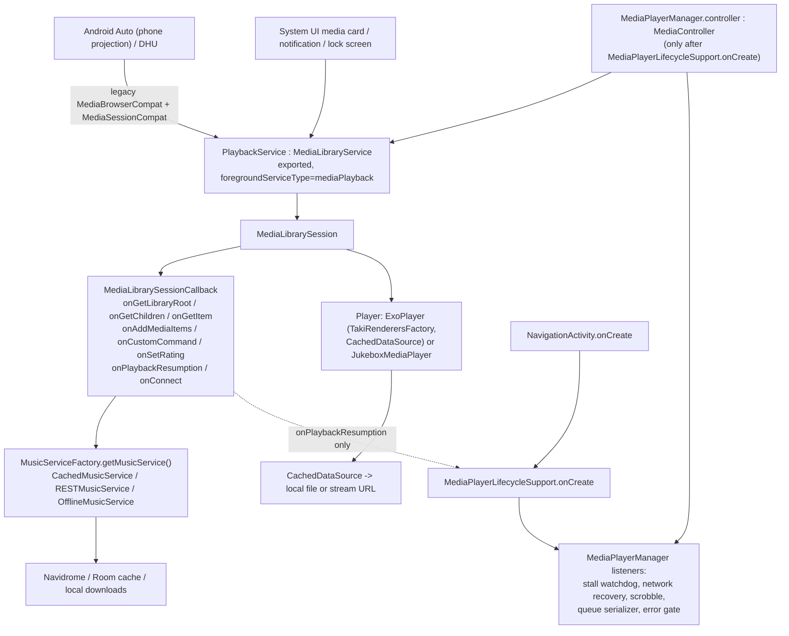

# Taki Android Auto: pre-beta architecture, compatibility and experience audit (Phase A)

Date: 2026-10-18. Tracking issue: #43 (umbrella, part of #36). Scope: static audit of the existing Android Auto integration. No production code, dependency or
device state was changed. Runtime behaviour in a real Android Auto environment is **not** verified by this document
(Phase B, section 15, covers that). Evidence labels used below:

- `CODE` - read directly from the repository (file:line at `develop` `8e5e7a04`).
- `LIB` - read from the shipped library bytecode (Media3 session 1.10.1, androidx.car.app 1.7.0) with `javap`.
- `DOC` - official Android developer documentation (fetched 2026-10-18); external claims are flagged as such.
- `UNVERIFIED` - inference that needs a runtime check.

## 1. Executive summary

Android Auto support is **present and architecturally sound at its core**: one Media3 `MediaLibraryService`
(`PlaybackService`) owns the single `ExoPlayer`, and the car, the notification, the phone app's own
`MediaController` and the lock-screen card all talk to that same player. There is no second playback engine.
Browsing, "play all", favourites, random songs, heart/shuffle/repeat custom actions, playback resumption (#37)
and an artwork provider are implemented, and the pagination design (manual "Show More" items with a 100-item
page) matches what the official docs say Android Auto supports.

No critical (P0) defect was found. Two findings need attention before declaring Android Auto beta-ready:

1. **AA-01 (P1, confirmed statically).** The "brain" that makes Taki's playback robust - the stall watchdog (#17),
   transient-network recovery (#19), controller rebuild (#18), scrobbling, error reporting and queue persistence -
   lives in `MediaPlayerManager`, attached through a `MediaController` that is only created by
   `MediaPlayerLifecycleSupport.onCreate()`. That is called by `NavigationActivity`, the media-button receiver path
   and `onPlaybackResumption` - **not** by `PlaybackService`, `onConnect` or any browse callback. A cold Android
   Auto session that never opens the phone UI therefore plays on the bare service player without those safeguards.
2. **AA-02 (P1 candidate, effect unverified).** Artist, album, playlist and sub-folder rows are built through an
   overload that sets `isBrowsable=false` and `isPlayable=false`; Media3 converts that to legacy flags `0`. The docs
   do not say how Android Auto renders a flag-less item. If it is not clickable, artist/album/playlist browsing is
   broken. This must be the first thing checked on the Desktop Head Unit.

Several P2 findings are lifecycle and robustness issues (an unbounded `CarConnection` observer, repeat-mode
override/restore semantics, a playlist cache not keyed by playlist, single-song queues, blocking calls on the
main thread, search gaps, no caller validation on the exported service). They are real code facts but have
bounded impact and are good targets for a small correction phase after Phase B.

**Beta readiness: REQUIRES_RUNTIME_VALIDATION.** Phase B can start without code changes.

## 2. Repository baseline

| Item | Value |
|---|---|
| develop HEAD / tree | `8e5e7a04`, working tree clean at audit start |
| Media3 | 1.10.1 (`media3-session`, `exoplayer`, `common`, `datasource(-okhttp)`, `inspector`), NextLib 1.10.1-0.13.0 |
| Car library | `androidx.car.app:app:1.7.0` (`libs.versions.toml:7`, `ultrasonic/build.gradle:207`); used only for `CarConnection` |
| minSdk / targetSdk | 26 / 37 (`versions.*` via `ultrasonic/build.gradle`), `<uses-sdk tools:overrideLibrary="androidx.car.app"/>` |
| Application IDs | release `io.github.churipakinti.taki`; debug `io.github.churipakinti.taki.debug` (`applicationIdSuffix`) - installable side by side |
| Android Automotive OS | not declared (no `android.hardware.type.automotive` feature, no AAOS-specific entries) |
| History | file is the Ultrasonic `AutoMediaBrowserCallback` ported to Media3 (2021-2023, upstream authors); Taki additions: resumption future (#37, `e66b15cd`), chunked Shuffle (HANDOFF), heart plumbing (#1, #15), native `HeartRating` icons |
| Existing GitHub issues | none cover Android Auto (searched all states); related: #17, #19, #34, #35, #37, #39, #40 |
| Inherited vs Taki | callback structure, `DISPLAY_LIMIT`, "Show More", repeat-all-on-projection (upstream `82f67586`, 2023-08-09), `observeForever` code: **inherited**. Resumption future, shuffle chunking, heart icon/rating pipeline, hardened artwork provider, monochrome notification icon: **Taki**. |
| Existing automated AA tests | **none** for `MediaLibrarySessionCallback`, `CarConnection` or browse trees (see section 12) |

## 3. Android Auto architecture



Entry points (all `CODE`):

- Discovery: `AndroidManifest.xml:45-46` `com.google.android.gms.car.application` -> `res/xml/automotive_app_desc.xml`
  (`<uses name="media"/>`); `:48-50` `com.google.android.gms.car.notification.SmallIcon` -> `@mipmap/ic_launcher`.
- Connection: `PlaybackService` (`:81-92`) is exported, `foregroundServiceType="mediaPlayback"`, with
  `androidx.media3.session.MediaLibraryService` and `android.media.browse.MediaBrowserService` actions.
  `FOREGROUND_SERVICE_MEDIA_PLAYBACK` is declared. The merged manifest also contains the car library's
  `androidx.car.app.connection.provider` provider (used by `CarConnection`); there is no `CarAppService`.
- Session: `PlaybackService.initializeSessionAndPlayer()` (`PlaybackService.kt:182-261`) builds the player
  (`createNewBackend`), then `MediaLibrarySession.Builder(this, player, MediaLibrarySessionCallback())` with
  `ArtworkBitmapLoader` and a session activity.
- Server change / jukebox switch: `updateBackend()` (`:263-293`) releases the player, builds a new one and does
  `mediaLibrarySession.player = player` (the callback is not recreated).
- Teardown: `onTaskRemoved` and `onDestroy` both call `releasePlayerAndSession()` (`:102-131`), i.e. swiping the
  task away stops playback by design (documented in the log message).
- Single engine: AA resolves items to `Track.toMediaItem()` (`MediaItemConverter.kt:61`), whose URI is
  `id|bitrate|filePath` - the same resolver and `CachedDataSource` path the phone UI uses. No separate car player.

## 4. Feature inventory

| Capability | Status | Evidence |
|---|---|---|
| Discoverable media app (`automotive_app_desc` media) | IMPLEMENTED (runtime unverified) | manifest `:45-46` |
| Media3 library integration (root, children, item, resumption) | IMPLEMENTED | callback `:204`, `:392`, `:416`, `:255` |
| Legacy `MediaBrowserService` compatibility | IMPLEMENTED via Media3 legacy stub | manifest `:89-90`; `LIB` `MediaLibraryServiceLegacyStub` |
| Browse: Library (random songs, liked songs, newest/recent/frequent/random/liked albums), Artists, Albums, Playlists | CODE_IMPLEMENTED | `getRootItems :783`, `getLibrary :829` |
| Offline browsing (Artists, Playlists; Library/Albums hidden) | CODE_IMPLEMENTED | `getRootItems :786-815` |
| Play album / playlist / liked / random ("Play All") | CODE_IMPLEMENTED | `addPlayAllItem :1338`, `onAddLegacyAutoItems :570` |
| Play a single song from a list | CODE_IMPLEMENTED (single-item queue, AA-07) | `playAlbumSong :1166` |
| Play artist directly (e.g. from search) | NOT_IMPLEMENTED | TODO at `:700`, `:740` |
| Browse search (`onSearch`/`onGetSearchResult`) | NOT_IMPLEMENTED | not overridden (grep) |
| Voice play-from-search | PARTIALLY_IMPLEMENTED | `onAddMediaItems :546` -> `playFromSearch :671` (AA-09) |
| Heart / shuffle / repeat custom actions | CODE_IMPLEMENTED | `onCustomCommand :428`, `buildCustomCommands :1400` |
| Playback resumption (media button after process death) | IMPLEMENTED (bounded future, #37) | `:255-280`, `RESUMPTION_TIMEOUT_MS` |
| Artwork for tracks | IMPLEMENTED via hardened content provider | `AlbumArtContentProvider` |
| Artwork for album/artist/playlist rows | NOT_IMPLEMENTED | rows built without `imageUri` (AA-11) |
| `notifyChildrenChanged` / refresh on server or offline change | NOT_IMPLEMENTED | grep: none |
| Content style hints | PARTIAL: only the group-title hint | `MediaItemConverter.kt:28-29,314` |
| Android Automotive OS | NOT_IMPLEMENTED (out of scope) | no automotive feature |

## 5. Navigation tree (as coded)

```
Root (MEDIA_ROOT_ID, FOLDER_MIXED)                       onGetLibraryRoot :204 (immediate future)
├─ Music Library (MEDIA_LIBRARY_ID) [online only]        getLibrary :829
│   ├─ Random songs (MEDIA_SONG_RANDOM_ID, browsable)    getRandomSongs :1222  (Play All + <=100 songs)
│   ├─ Liked songs  (MEDIA_SONG_STARRED_ID, browsable)   getStarredSongs :1173 (Play All + first 100)
│   ├─ Newest / Recent / Frequent / Random / Liked albums getAlbums(type) :1025 (100 + "Show More" page item)
├─ Artists (MEDIA_ARTIST_ID)                              getArtists :887
│   ├─ <=100 artists -> artist rows (MEDIA_ARTIST_ITEM|id|name)
│   └─ >100 -> alphabetical section rows (MEDIA_ARTIST_SECTION|X) -> artist rows (unbounded within a section)
│        └─ artist -> albums (MEDIA_ALBUM_ITEM|id|name)   getAlbumsForArtist :943
│             └─ album -> [Play All] + songs (MEDIA_ALBUM_SONG_ITEM|albumId|name|songId, first 100)  getSongsForAlbum :971
├─ Albums (MEDIA_ALBUM_ID) [online only]                  getAlbums(SORTED_BY_NAME) :1025, pages via MEDIA_ALBUM_PAGE_ID|type|n
└─ Playlists (MEDIA_PLAYLIST_ID)                          getPlaylists :1077 (all playlists, no limit)
     └─ playlist -> [Play All if >1] + first 100 songs (MEDIA_PLAYLIST_SONG_ITEM|...)  getPlaylist :1097
```

Per level: data comes from `MusicServiceFactory.getMusicService()` (re-resolved per call, so a server switch is
picked up); all calls hop `mainScope.future { serviceScope.future { ... }.await() }` (the code comment says Media3
needs the main thread while networking must not run on it); media IDs are `TYPE|id|name[|songId]` strings;
parents are encoded in the ID so Back is handled by Android Auto's own history; failures return an **empty
successful list** (`callWithErrorHandling :1359`) rather than an error.

### Pagination and the limits (valid design, with caveats)
- `DISPLAY_LIMIT = 100` (`:88`) is applied as: album lists - server-side `size=100&offset=page*100` with a
  "Show More" browsable item when a full page came back (`getAlbums :1032-1071`, stable ordering for
  `SORTED_BY_NAME`/`NEWEST`/`RECENT`/`FREQUENT`/`STARRED`; `RANDOM` can repeat across pages); artists > 100 -> letter
  index; songs in album / playlist / liked: `take(100)` for display only.
- `onGetChildren` **ignores `page`, `pageSize` and `params`** (`:416-426`). `DOC`: "Android Auto and AAOS don't
  support pagination ... don't rely on the page or pageSize parameters" - so this is **correct for Android Auto**.
  `LIB`: legacy browsers get `pageSize = Integer.MAX_VALUE` unless they pass `EXTRA_PAGE_SIZE`; a Media3
  `MediaBrowser` client that passes a smaller `pageSize` would make `MediaLibrarySessionImpl` throw
  `IllegalStateException("Invalid size=..., pageSize=...")` (low relevance: only Taki's own controller uses it).
- "Play All" is not capped: `playAlbum`/`playPlaylist` return all tracks, but `playStarredSongs` plays the cached
  `take(100)` list (AA-07).
- No item becomes unreachable beyond 100 in album lists. Within a >100 artist section, the section itself is not
  paged. Albums with >100 tracks show only the first 100 rows (Play All still plays all).

## 6. Playback and queue integration

- All custom actions and queue changes go to the one session player: `session.player` for shuffle/repeat
  (`:450-458`), `onSetRating` -> `RatingManager` (`:479-530`).
- Item resolution: Media3-aware controllers send `requestMetadata.mediaUri` and the item is rebuilt with that URI
  (`:550-559`); legacy Android Auto sends only a media ID and goes through `onAddLegacyAutoItems` (`:570-616`),
  which resolves the tracks (Room/network) and returns `Track.toMediaItem()`. Both paths end in the same player,
  `CachedDataSource` (local file or stream), `TakiRenderersFactory` (hi-res FFmpeg, #17), offload and watchdog
  policies; nothing in the car path bypasses cache/download/resolver logic.
- **Controller-side safeguards (AA-01).** The following exist only on `MediaPlayerManager.listeners`, attached to
  its `MediaController` (`MediaPlayerManager.kt:604-625`): stall watchdog tick (`:249-257`, #17 FIX B), transient
  network recovery (`:373-413`, #19), error reporting and album-cache invalidation (`:418-446`), scrobbling
  (`:316-320`), sleep-timer completion, queue checkpoints/serialisation (`:249-257`, `:1281`, `:1355`). The
  controller is created by `MediaPlayerManager.onCreate` (`:525`) <- `MediaPlayerLifecycleSupport.onCreate`
  (`:56-60`) <- `NavigationActivity.onCreate` (`:391`), `UltrasonicIntentReceiver` command path, and
  `onPlaybackResumption` (`MediaLibrarySessionCallback.kt:262`). `PlaybackService.onCreate` does not call it; the
  only service-side use is `serializeCurrentSessionSync()` at teardown (`PlaybackService.kt:119`), which returns
  early when `currentMediaItemIndex == -1` (controller absent). `RxBus.createServiceCommandPublisher`
  (`RxBus.kt:114`) has a subscriber in `MediaPlayerLifecycleSupport:45` but nothing publishes to it.
  Consequence for an AA-only session: no silent-stall backstop, no in-place network retry (#19), no scrobble,
  no persisted queue, and a phone UI that attaches later only sees the state after the fact. `UNVERIFIED` at
  runtime: confirm that the log line `MediaPlayerController started` never appears in a cold AA session.
- Errors: a playback error is delivered by Media3 to Android Auto as a playback-state error; Taki's friendly
  message (`reportPlaybackError`) is also controller-side. Errors cannot silently advance the queue from the
  callback code itself (the callback never skips).
- Commands: `onConnect` (`:224-244`) accepts every controller, adds the custom session commands and calls
  `configureRepeatMode`. All exposed commands map to real `Player` operations; the "Placeholder" button is
  disabled by design (it pads the button layout when there is no Next item, `:1410-1417`).
- Queue shape: tapping a song plays **that song only** (`playAlbumSong/playPlaylistSong/playStarredSong/
  playRandomSong/playSearch` all return `listOf(song)`, `:778`, `:1156`, `:1169`, `:1218`, `:1266`); the full
  context is queued only through the "Play All" row. The code comment states Android Auto "only select[s] a single
  item at once".
- Resumption (#37): bounded by a 20 s timeout and completes with the restored queue or an error (`:255-280`) -
  well implemented and covered by unit tests of `resumptionOf`.
- Interaction with prior fixes: #17 (FFmpeg route) is renderer-level and applies to car playback; the watchdog and
  #19/#18 recovery do not (AA-01); #34 audio focus is configured in the player builder (applies); #37 applies;
  #39/#40 are download/`CachedDataSource` level (apply). No completed issue needs re-opening on this evidence.

## 7. Connection lifecycle (`CarConnection`)

`configureRepeatMode(session.player)` (`:282-314`) is called from **every** `onConnect` (`:238`) - including the
phone app's own controller, the notification and System UI - not only from Android Auto. Each call:
1. creates a new `CarConnection(UApp.applicationContext())` and calls `.type.observeForever { ... }` (`:289`);
2. captures `player` and `player.repeatMode` at that moment as `originalRepeatMode`;
3. is never removed (`removeObserver` does not appear for it; the service has no teardown hook for it).

`LIB`: `CarConnectionTypeLiveData.onActive()` calls `Context.registerReceiver(...)` and `queryForState()` issues an
`AsyncQueryHandler.startQuery`; `onInactive()` unregisters. Because the observer is never removed, every
`onConnect` leaves one registered receiver, one content query on each active state and one lambda that holds the
captured `player` and the callback alive until the process dies. Duplicate observers are tolerated only because the
shared `customRepeatModeSet` flag makes all but the first one a no-op, which also means the **first** observer's
captured `originalRepeatMode` is the one that is restored (see section 8). This is an unmanaged lifecycle with
retained references, not just a style issue; its practical cost per connect is small but unbounded over a long
process life (Taki controllers reconnect on rebuild, app launches, notification refresh).

Other lifecycle facts: `updateBackend()` replaces the player (`:285-290`) but the captured `player` in older
observers still points at the released instance, so a later repeat change would be applied to a dead player and the
live one would keep its mode (`UNVERIFIED` runtime effect). `CONNECTION_TYPE_NATIVE` (AAOS) is deliberately
ignored. `serviceJob`/`serviceScope`/`mainScope` (`:106-108`) are never cancelled; coroutines in flight at
`onDestroy` are left to finish. Disconnection is handled only through the `NOT_CONNECTED` event of that observer.

## 8. Repeat and shuffle behaviour

- Origin: upstream Ultrasonic commit `82f67586` (2023-08-09, "Utilize CarConnection to determine whether to set
  repeat mode to ALL"), which replaced an unconditional `player.repeatMode = REPEAT_MODE_ALL` in `onConnect`. The
  rationale is not documented in Taki's docs. It is inferred from the layout code: with `REPEAT_MODE_ALL` the
  Next button stays available on the last item, otherwise a disabled "Placeholder" is inserted
  (`buildCustomCommands :1410-1417`). Not required by Android Auto (`DOC` lists no such rule).
- Effects (all `CODE`): while projecting, repeat is forced to ALL once (`:299-304`); when the type becomes
  `NOT_CONNECTED` it restores `originalRepeatMode` (`:306-311`).
  - It **overwrites the user's repeat preference** while projected, and because the controller-side serializer
    persists `repeatMode` (`MediaPlayerManager.kt:1287`) the forced ALL can be saved if the process dies while
    connected (only if AA-01's manager is attached).
  - `originalRepeatMode` is a snapshot from the *first* `onConnect` of the process, not from the moment the car
    connected: if the user changes repeat after that and then plugs in the car, disconnecting restores the stale
    value.
  - A repeat toggle from the car sets `customRepeatModeSet = true` (`:455`), so on disconnect the user's in-car
    choice is reverted to the stale snapshot, and projection start will not re-apply ALL.
  - Unexpected disconnects follow the same path; if the process is killed there is no restore and (with the
    manager attached) ALL can persist.
- Shuffle: custom command shuffles the queue **after** the current item in chunks with yielding and the timeline
  publish suppressed (`:1446-1482`) - the chunked ANR protection from the earlier audit; correct and worth keeping.
  Shuffle availability requires more than 2 items (`canShuffle :1398`).
- Verdict: intentional, upstream-inherited, mostly safe, but its snapshot/flag semantics are fragile. Do not
  remove it without an approved behaviour change; test the sequences in section 15 (scenarios 11, 13).

## 9. Artwork, metadata and presentation

- Track artwork: `toMediaItem` -> `AlbumArtContentProvider.mapArtworkToContentProviderUri` (`content://<id>.provider.AlbumArtContentProvider/<coverArt>|<md5>_large`). The provider is exported (needed by Android Auto and
  the launcher) but validates the key pattern, requires the `(coverArtId, key)` pair to have been minted by Taki
  and checks canonical containment in the artwork directory; unit-tested (`AlbumArtContentProviderTest`, 6
  tests). Preserve this.
- Gaps: album, artist, playlist and folder rows carry no `artworkUri` and no subtitle (`buildMediaItem` called
  without `imageUri`/`artist` in the `String` overload) - Android Auto lists show text only (AA-11). Root and
  library rows use `android.resource://` drawables (`Util.getUriToDrawable`) which Android Auto reads itself.
  `openFile` triggers an asynchronous cover download and returns `null` when the file is not yet on disk, so the
  first request for uncached art can fail; the minted-key map is in memory only (`UNVERIFIED` impact).
  `ArtworkBitmapLoader.load` does `require(parts.count() == 2)` (`:60`): non-`id|key` URIs would throw
  synchronously (they are not routed there in the current flows).
- Identity: app label and about text say Taki; the notification small icon for the media notification is the
  monochrome `ic_launcher_monochrome` (`PlaybackService.kt:92`), but the Android Auto notification icon metadata
  points at the colour `@mipmap/ic_launcher` (`AndroidManifest.xml:48-50`), whereas Android Auto notification icons
  are normally monochrome (`UNVERIFIED` rendering). Remaining Ultrasonic-era strings visible to the system: the error
  notification channel name `"Ultrasonic error messages"` (`PlaybackService.kt:483`, only in system notification
  settings); custom action labels are hard-coded English: "Love", "Dislike", "Shuffle", "Repeat None/One/All"
  (`:328-389`) and the root title "Root Folder" (`:214`); none are localised (AA-13).
- Heart state: `HeartRating` icons are the app's own heart drawables; `setStarred()` keeps the MediaItem in sync
  (#1/#15), so the heart shown for the playing item follows `onMediaItemTransition`.
- Do not build a custom car UI; Android Auto controls the presentation.

## 10. Performance and reliability

- Futures: every browse future either completes with a list or an empty list (`callWithErrorHandling` swallows
  exceptions); a hung HTTP call is bounded only by the network client's own timeouts. `onGetLibraryRoot` is an
  immediate future, matching the doc requirement to return the root quickly (`DOC`). `onPlaybackResumption` has an
  explicit timeout. There is no timeout/cancel on browse futures and no error state (AA-10).
- Main-thread waits (AA-08): `onAddMediaItems`/`onGetItem` run on the session's application looper (the main
  looper). `onAddLegacyAutoItems`/`tracksFromMediaId` call helpers that block with `serviceScope.future{...}.get()`
  (`:1138-1141`, `:1150-1153`, `:1254-1256`, `:1272-1287`). Albums are cache-first (`CachedMusicService` reads the
  persisted Room rows first, `CachedMusicService.kt:243-247`), so album play after browsing is a short DB read;
  playlists, liked songs, random songs and search have no such cache once the in-memory copies are gone, so those
  paths wait for a network call on the main thread (ANR risk when the server is slow or unreachable).
- Stale state: `playlistCache`, `starredSongsCache`, `randomSongsCache`, `searchSongsCache` (`:110-113`) are never
  invalidated on server or offline change; `playPlaylist/playPlaylistSong` do not check the cache belongs to the
  requested playlist id (AA-06). `notifyChildrenChanged` is never called, so a server switch or offline toggle does
  not refresh a car screen that is already open.
- ID parsing: IDs are `|`-joined and indexed positionally (`:576-603`); names containing `|` shift the fields.
  `getSectionFromName(name)` calls `name.first()` (`:1349`) and would throw for an empty artist name, failing the
  whole artist list future. Album folder rows are sorted **after** `take(100)` with a comparator that returns 1 for
  two files (`:988-998`), which violates the `Comparator` contract (harmless for small lists).
- Large libraries: artists use a letter index above 100; albums page server-side; playlists are returned in full;
  artist sections and playlist rows are not paged. Network cost per browse is one cached call; no per-item calls.
- Security/privacy (AA-05): `PlaybackService` is exported (required) and `onConnect` accepts every caller, and
  `onGetLibraryRoot` serves the library to any bound client; there is no package/signature allow-list, so any
  installed app can browse metadata, control playback and invoke the custom commands (heart, shuffle, repeat).
  `UltrasonicIntentReceiver` is also exported for transport commands. This is the common open-by-default pattern
  for media apps but has no mitigation.
- Background execution: `foregroundServiceType=mediaPlayback` and `onForegroundServiceStartNotAllowedException`
  handling exist (`PlaybackService.kt:436-468`).

## 11. Existing test coverage

Related tests that exist and were run for this audit (33 tests, 0 failures, `:ultrasonic:testDebugUnitTest` filter):
`PlaybackResumptionTest` (4), `MediaPlayerLifecycleSupportTest` (3), `QueueRestoreRoundTripTest` (5),
`MediaItemTransitionRoutingTest` (9), `AlbumArtContentProviderTest` (6), `MediaItemConverterStarredTest` (6).

| Scenario | Covered |
|---|---|
| Resumption queue contract | yes (`resumptionOf`), not the future wiring |
| Artwork provider validation | yes |
| Media-item conversion / heart state | yes |
| Root browsing, artist/album/playlist navigation, media IDs, "Show More" paging | **no** |
| Browsable/playable flags | **no** |
| Search / voice play | **no** |
| Offline root | **no** |
| Server error / empty result handling | **no** |
| `CarConnection` lifecycle, repeat override/restore | **no** |
| Custom commands (heart/shuffle/repeat) | **no** |
| Cold-start (no activity) behaviour of the controller-side manager | **no** |

## 12. Confirmed defects versus potential risks

Confirmed by code or library bytecode (facts): AA-01, AA-03, AA-04, AA-05, AA-06, AA-07, AA-08, AA-09, AA-10, AA-11,
AA-12, AA-13. Effect not known without a runtime check: AA-02 (and the runtime impact of AA-01/AA-03/AA-08).
No confirmed P0. Counts: P0 confirmed 0; P1 confirmed 1 (AA-01) plus 1 unverified candidate (AA-02); P2 8; P3 4.

## 13. Prioritised findings

| ID | Sev | Component | Location | Observed | Expected | Evidence / confidence | Runtime test | Next action |
|---|---|---|---|---|---|---|---|---|
| AA-01 | P1 | Controller-side safeguards | `PlaybackService.kt:90-261`, `MediaPlayerManager.kt:525-625`, `MediaPlayerLifecycleSupport.kt:56-60`, `MediaLibrarySessionCallback.kt:224-244` | Watchdog, #19 recovery, scrobbling, error reporting and queue persistence attach only through `MediaPlayerManager.onCreate`, not triggered by service start, `onConnect` or browse | Car playback gets the same safeguards as phone playback | CODE, high | yes (cold DHU start, check `MediaPlayerController started`) | small fix: start the lifecycle support from the service/`onConnect` (decision needed), plus a test |
| AA-02 | P1 candidate | Browse flags | `MediaLibrarySessionCallback.kt:1289-1304`, `MediaItemConverter.kt:277-` | Artist/album/playlist/folder rows use the `String` overload (`isBrowsable=false`, playable false) -> legacy flags 0 (`LIB LegacyConversions.convertToBrowserItem`) | Browsable folder rows, playable leaves | CODE+LIB for the flags, effect UNVERIFIED (docs silent) | **first DHU check** | if broken, set `isBrowsable=true` for folder rows; add a unit test of flags |
| AA-03 | P2 | CarConnection | `:282-314` | Observer per `onConnect`, never removed, captures player and callback | One owner, removed on teardown | CODE+LIB, high | optional (count receivers over reconnects) | single observer owned by the callback/service, removed in `onDestroy` |
| AA-04 | P2 | Repeat mode | `:285-311`, `:455` | Stale snapshot restore, overwrites preference, in-car toggle reverted | Restore the value the user had when the car connected | CODE, high | yes (section 15 #11/#13) | record/restore at projection start; keep ALL behaviour |
| AA-05 | P2 | Session access | `:224-244`, manifest `:81-92` | Any app may connect and browse/control | Allow-list or trusted-caller check for non-system controllers | CODE, high | no | decision; small `onConnect` check keeping Android Auto/System UI/Assistant |
| AA-06 | P2 | Playlist play | `:1134-1158` | `playlistCache` returned without checking playlist id or server | Cache keyed by playlist id and server | CODE, high | yes (open playlist A, then B, replay A) | key or drop the cache; invalidate on server switch |
| AA-07 | P2 | Queue shape | `:778`, `:1156`, `:1169`, `:1187-1209`, `:1218`, `:1266` | Song tap = single-item queue; liked "Play All" plays only the first 100 | Album/playlist context queued; full liked list | CODE, high | yes (UX) | queue the parent list from the chosen song; decide on liked limit |
| AA-08 | P2 | Main-thread blocking | `:1138-1141`, `:1150-1153`, `:1254-1256`, `:1272-1287` via `:399`, `:566` | `.get()` waits on the main looper for network | Async resolution | CODE, medium (album path cache-first) | yes (idle 15 min then play, offline server) | resolve asynchronously in `onAddMediaItems` |
| AA-09 | P2 | Search / voice | `:671-728`, `:546` | No browse search; voice picks the first album, throws on no result (`mediaItems.first()`, `:721`), no empty-query handling, comment claims exact match/random fallback | Graceful result or error; empty query plays something | CODE, high | yes (voice + DHU) | decide scope; fix the `first()` crash path at least |
| AA-10 | P2 | Errors / refresh | `:1359-1367`, no `notifyChildrenChanged` | Failures look like empty lists; no refresh on server/offline change | Visible error state, refresh on change | CODE, high | yes (server down, offline toggle) | small: return an error result; notify on server change |
| AA-11 | P3 | Artwork/metadata | `:1289-1304`, `AlbumArtContentProvider.openFile`, manifest `:48-50` | No art/subtitle on album/artist/playlist rows; first art request may return null; colour small icon | Art + subtitle where AA shows them | CODE, medium | yes | optional polish |
| AA-12 | P3 | Robustness | `:1349`, `:576-603`, `:988-998` | `first()` on empty name, `|` in names, sort-after-truncate, comparator contract | Safe parsing | CODE, high | no | small hardening |
| AA-13 | P3 | Labels | `:214`, `:328-389`, `PlaybackService.kt:483` | English hard-coded labels, "Ultrasonic error messages" | Localised Taki strings | CODE, high | no | optional |
| AA-14 | P3 | Pagination contract | `:416-426` | `page/pageSize` ignored | Correct for AA (`DOC`); would throw for a Media3 client with small `pageSize` (`LIB`) | LIB, high | no | document only |

Items that are **valid and should be preserved**: manual "Show More" paging with 100-item pages (`DOC` says AA has no
pagination); root with at most four browsable tabs (Library, Artists, Albums, Playlists online; two offline) and an
immediate root future; one authoritative `ExoPlayer`/`CachedDataSource` path; resumption with timeout (#37);
chunked/yielded Shuffle; hardened `AlbumArtContentProvider`; heart pipeline (#1/#15); `foregroundServiceType`
and the foreground-start-not-allowed handler; offline-aware root.

## 14. Compatibility and discovery assessment

- Phone projection: the `com.google.android.gms.car.application` metadata with `<uses name="media"/>`, an exported
  `MediaLibraryService` (legacy `MediaBrowserService` action present) and a media session are the declarations the
  official guide expects (`DOC`: "needs a `MediaBrowserService` or `MediaLibraryService`, plus a `MediaSession`").
  A manifest alone does not prove discovery; it must be seen in the DHU launcher.
- Debug vs release: same code; only the application ID differs (`.debug`). Release is `minify`+`shrinkResources`;
  keep rules should be confirmed for `androidx.car.app` (the `CarConnection` call path) in release.
- Sideloaded builds: `DOC` (testing page): to test in a real vehicle the app must come from a trusted source such
  as Google Play (Internal App Sharing/Internal Test Track), **except** that the Android Auto developer option
  "Unknown sources" lets media apps run that are not from a trusted source. The DHU also needs Android Auto
  developer mode (tap the version 10 times) and "Start head unit server".
- Distribution: for Google Play listing, `DOC` states apps must meet the car app quality/design requirements before
  being listed for Android Auto. Taki's distribution channel for beta is not defined in the repository.
- Android Automotive OS: **out of scope**; nothing declares it and it requires a separate feature declaration and
  distribution. Do not add it as part of this work.
- Root hints: the root tab limit is 4 and tabs must be browsable (`DOC`); Taki online has exactly four browsable
  root items, so it is compliant but at the limit.

## 15. Phase B: Desktop Head Unit validation plan

Environment facts at audit time: DHU is **not installed** (`%LOCALAPPDATA%\Android\Sdk\extras\google\auto` does
not exist); the Pixel 7 was **not connected** to adb during this audit; Android Auto app version and developer
mode state were not checked. Nothing was installed or changed. Before starting Phase B (user actions): install the
"Android Auto Desktop Head Unit Emulator" from the SDK Manager (needs authorisation), enable Android Auto
developer mode on the phone, enable "Unknown sources" for the debug build, start the head unit server, then
`adb forward tcp:5277 tcp:5277` and run `desktop-head-unit` (ADB tunnelling; or `--usb`, `DOC`). Test with the
**debug package** (`...taki.debug`, already installed) so the release install is never touched; repeat a short
smoke on the release package afterwards. Useful DHU keycodes: `media_play_pause`, `media_next`, `media_previous`;
`playbackstatus = true` in the config shows state. Capture with `adb logcat` (Taki Timber logs in debug) and the
Media Controller Test app.

| # | Scenario | Preconditions | Procedure | Expected | Evidence | Pass/fail |
|---|---|---|---|---|---|---|
| 1 | Discovery + flag-less rows (AA-02) | DHU connected, debug app installed | Open media launcher; open Taki; open Artists, Albums, Playlists | Taki listed; every row clickable and opens | screenshots, log | any non-clickable row = fail (P1) |
| 2 | Cold start, no phone UI (AA-01) | Force-stop app, phone locked, no Activity | Open Taki from DHU, browse, play a track | Playback works; log `MediaPlayerController started` present | logcat | missing line = AA-01 confirmed |
| 3 | Library browsing | Online, server reachable | Root -> Library -> each sub list | Lists load < 5 s; labels correct | screenshots, timing | blank/error = fail |
| 4 | Artists | Library > 100 artists | Open Artists | Letter index, then artists, then albums | screenshots | all reachable = pass |
| 5 | Albums + Show More | Library > 100 albums | Albums -> Show More until end | No duplicates, stable order | counts | pass if complete |
| 6 | Playlists | Playlist with > 100 songs | Open playlist, Play All, tap a song | Play All queues all; song tap queues? (AA-07) | queue contents | record behaviour |
| 7 | Favorites | Liked songs exist | Library -> Liked songs -> Play All | Plays liked songs (note 100 limit) | queue size | compare to server |
| 8 | Search / voice | DHU voice or Assistant | "Play <exact song>", "Play <missing>", empty query | Match plays; missing = clean error; empty = something plays | logcat, behaviour | crash/no response = fail (AA-09) |
| 9 | Artwork | Cold cache | Browse then play tracks | Cover shown for now playing | screenshots | missing art noted (AA-11) |
| 10 | Transport | Playing | Play/Pause/Next/Previous/seek | Correct, no queue change | log | pass |
| 11 | Shuffle/Repeat | Queue >= 3 | Toggle shuffle, repeat in car; disconnect | Repeat reflects choice; phone repeat sane after disconnect | log, phone UI | stale restore = AA-04 |
| 12 | Background playback | Playing | Lock phone, 10+ min | Continues; no stall | log | pass |
| 13 | Disconnect/reconnect | Playing, repeat OFF then ONE on phone | Connect car, disconnect, reconnect x3 | One observer effect, repeat per rules | log, receiver count | duplicates = AA-03 |
| 14 | Offline playback | Airplane mode, downloaded tracks | Browse Artists/Playlists, play | Only offline items; plays | log | pass |
| 15 | Missing/unavailable track | Track id invalid on server | Play it | Error shown; no silent advance | screenshot, log | silent skip = fail |
| 16 | Large library speed | Largest library | Cold browse to deep album | Responsive; no ANR | timing, ANR log | ANR = fail (AA-08) |
| 17 | Return to phone | Car disconnect | Open phone app | Same queue/position | UI | pass |
| 18 | Continue after AA disconnect | Playing in car | Disconnect | Playback continues on phone, no resume of paused state | log | pass |
| 19 | Stale playlist (AA-06) | Two playlists | Browse A, browse B, back to A, Play All | Plays A | queue | wrong list = fail |
| 20 | Idle then play (AA-08) | Browse album, wait 15 min | Play a song | No freeze | timing | freeze > 5 s = fail |

## 16. Beta-readiness assessment

**REQUIRES_RUNTIME_VALIDATION.** The integration is real and mostly well built, no P0 is known, and Phase B needs no
code changes. It is not safe to call beta-ready until (a) scenario 1 shows the flag-less rows are usable and (b)
scenario 2 shows what happens without the phone UI (AA-01). If either fails, a small, focused correction phase
should precede the beta; the P2 items can follow the beta unless the DHU shows user-visible breakage.

## 17. Recommended next steps

1. Run Phase B scenarios 1, 2, 8, 13 first (they decide the P1 items), then the rest of the matrix.
2. If AA-01 is confirmed: decide where `MediaPlayerLifecycleSupport.onCreate()` is triggered for service-only
   starts (for example from `PlaybackService`) and add a unit/cold-start test.
3. If AA-02 breaks browsing: set `isBrowsable=true` for artist/album/playlist/folder rows and add a flags test.
4. Then, in one small phase: single `CarConnection` observer with teardown and a repeat snapshot taken at
   projection start (AA-03/04), key/invalidate the playlist cache (AA-06), fix the `first()` search crash (AA-09),
   queue album/playlist context for song taps (AA-07), asynchronous item resolution (AA-08).
5. Defer to after beta: row artwork/subtitles, localisation, `notifyChildrenChanged`, error states, caller
   allow-list decision (AA-05), minor parsing hardening.
6. Explicitly out of scope: Compose or custom car UI, Android Automotive OS, changing `DISPLAY_LIMIT` without data.

Official documentation used (fetched 2026-10-18): Android for Cars media overview, content hierarchy, voice actions,
playback errors, testing and DHU pages on developer.android.com (`/training/cars/media`, `.../content-hierarchy`,
`.../voice-actions`, `.../errors`, `/training/cars/testing`, `/training/cars/testing/dhu`).
